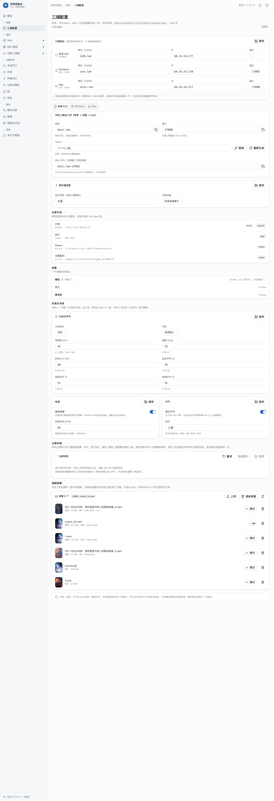
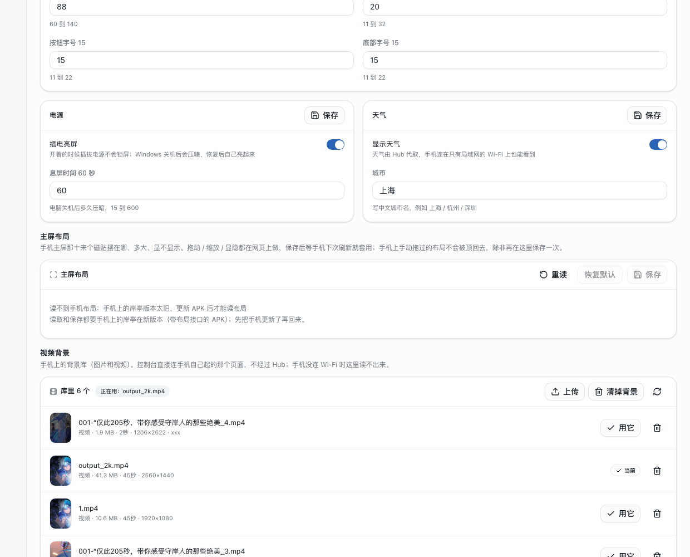
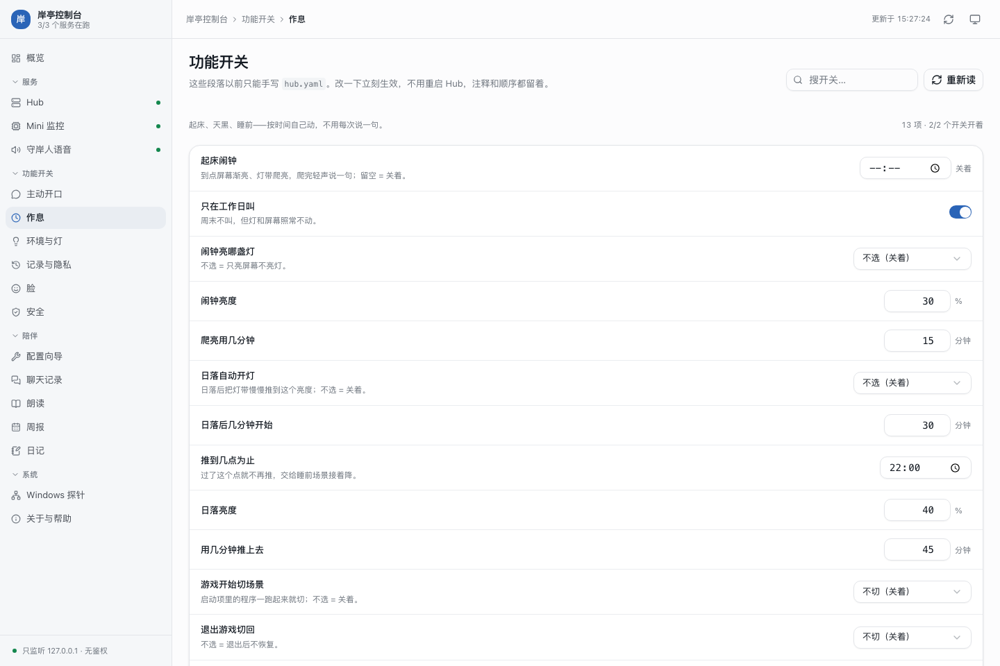

# 岸亭控制台

Mac 本机的服务控制台：浏览器里启停 Hub / Mini 监控 / 守岸人 TTS 三个 LaunchAgent，看健康与日志，确认 Windows 在不在线，顺手把配置向导、聊天记录、朗读、周报与日记也都收在同一个页面里。只监听 `127.0.0.1`、无鉴权，不要暴露到局域网。


## 跑

```bash
cd console
./dock-console
```

纯 Python 标准库，不需要装依赖。会自动开浏览器；`--port` 换端口（默认 17880），`--no-browser` 不开。Ctrl+C 只退出控制台，不会停服务本身。

需要 3.10 以上：页面转发那些代码用了 `dict[str, Any] | None`，macOS 自带的 `/usr/bin/python3` 是 3.9，会直接 `TypeError`。装过 Homebrew python 就没问题——app 拉起时 `PATH` 里 `/opt/homebrew/bin` 排最前，就是这个原因。

## 平时由 app 拉起

日常不用开终端：双击 `岸亭控制台.app`，它启动时会先探 `127.0.0.1:17880/api/status`，没人应答就以 `python3 -m dock_console --no-browser` 把服务端拉起来，输出写进 `~/Library/Logs/岸亭控制台.log`。

服务端跟着 app 一起走：菜单栏「退出」时 `terminate()` 收掉子进程；**即使 app 是被强杀的**，服务端也会在 2 秒内自己退出（`follow_parent()` 盯着父进程，被 launchd 收养就收工）。所以不会出现「旧进程还占着 17880、新 app 以为已经有人服务、于是不拉起新代码、页面永远是旧的」——这个坑踩过一次。

改完控制台代码要生效，让它重新拉一次就行：

```bash
# 菜单栏点「退出」，然后
open "/Users/weiekko/dock/console/岸亭控制台.app"
```

只刷新浏览器标签没用，Python 那边还是旧代码。

## 菜单栏

`menubar/main.swift` 编译成 `岸亭控制台.app`：常驻菜单栏，一键打开控制台各页（含功能开关），下拉直接启停三个服务并显示状态。仓库里提交了编译好的 app，日常双击即可；改了 `main.swift` 后重新编译：

```bash
swiftc -parse-as-library menubar/main.swift -o "岸亭控制台.app/Contents/MacOS/ShoretingConsole"
```

（`-parse-as-library` 是 Swift 6 的要求：`@main` 和文件里的顶层常量不能同时存在。老的命令会报 `'main' attribute cannot be used in a module that contains top-level code`。）

## 管理的服务

| id | 名字 | LaunchAgent | 端口 | 安装脚本 |
|---|---|---|---|---|
| `hub` | Hub（门口） | `cn.weiekko.dock-hub` | 17890 | `hub/install-launchd.sh` |
| `mini` | Mini 监控 | `cn.weiekko.helm-mini` | 17891 | `mini/install-launchd.sh` |
| `tts` | 守岸人 TTS | `cn.weiekko.companion-tts` | 18100 | `companion/tts/install-launchd.sh` |

Windows 探针不再单独一页：地址、口令、回连、监听、掉线阈值都在「三端配置」的 Windows tab 里，概览页那张卡只显示在线状态和当前地址。

## 页面结构

一个单页应用，左边多级导航，右边内容：

- **概览** — 三个服务的状态、Windows 探针、Hub 最近日志
- **配置** — 三端配置（`#/hub/setup`）：安卓 / Windows / Mac 三个 tab + 一份三端地址簿
- **服务** — Hub / Mini 监控 / 守岸人语音，各自的状态、日志、接口
- **功能开关** — `hub.yaml` 里那些只能手写的段落，按组分
- **陪伴** — 聊天记录、朗读、周报与日记（一页两个 tab：这一周 / 日记）
- **系统** — 关于与帮助

这几页原本是 Hub 自己的一套 HTML（`/setup`、`/chats`、`/read`、`/week`、`/diary`），现在全部用同一套 shadcn/ui 组件重写了，不再是 iframe 套页面；Hub 那套页面本身还能直接用浏览器打开，只是控制台不再引用。周报和日记合成一页（`#/hub/journal`），`#/hub/week`、`#/hub/diary` 两个老地址会落到这一页的对应 tab；`#/windows` 会落到三端配置的 Windows tab。

## 前端

页面源码在 `console/web`（React + TypeScript + Vite + Tailwind + shadcn/ui）。构建产物落到 `dock_console/assets/`，运行时由 Python 直接发，**不需要装 Node**：

```bash
cd console/web
npm install      # 只有第一次
npm run build    # -> ../dock_console/assets/console.js / console.css
```

改了页面要重新 `npm run build`，再重启控制台（见上面「改完控制台代码要生效」）。组件用 `npx shadcn@latest add <name>` 拉，源码在 `web/src/components/ui`。

## Hub 的数据怎么进来

聊天记录、朗读队列、配置向导这些数据都在 Hub（17890）那边。浏览器直接 fetch 会跨端口，所以控制台后端起了一层同源转发：`/api/hub/<path>` → `http://127.0.0.1:17890/<path>`，GET / POST / DELETE 都过，JSON 和 wav 原样搬（`dock_console/hub_proxy.py`）。请求从 `127.0.0.1` 发出，Hub 按「本机」放行，Token 不进浏览器。

## 三端配置

`#/hub/setup` 一页管三台机器，数据都走 Hub 的 `/setup/api/state` 与 `/setup/api/save`：

| tab | 改什么 |
|---|---|
| 安卓 K20 | 手机上要填的地址 / 端口 / Token（可复制）、Mini CPU 地址、室内温湿度、主屏方块与场景（只读）、**外观与字体 / 电源 / 天气 / 视频背景** |
| Windows | `probe` 段整段（地址、口令、回连、监听、掉线阈值）、`pc` 的监控开关与采样、`media`、启动项清单 |
| Mac | `name` / `host` / `port` / Token、伴侣大模型、声音与朗读服务、`mini` 监控、米家登录 |



页头那张「三端地址」表写 `hub.yaml` 的 `nodes:` 段：`mac` / `win` / `android` 各一个 `host`（域名）、`ip`、`port`。
域名由路由器的静态 DNS 绑定，换网段只改路由器那三行；安卓页显示的就是 `nodes.mac`，Windows 页的「用域名填」按钮从 `nodes.win` 取值。

### 手机端那几项（外观 / 电源 / 天气 / 视频背景）

这些值本来只活在手机的 DataStore 里，控制台既看不见也改不了。现在分两条路走：

- **外观与字体、电源、天气** 走 Hub：`POST /setup/api/phone` 写 `hub.yaml` 的 `phone:` 段，`rev` 自动 +1，然后跟着 `/v1/snapshot` 的 `phone` 字段下发。手机记着自己套用到哪一版（`appliedPhoneRev`），**只有 rev 变大才覆盖本地值**——所以在手机上手动调过的字号、城市不会被 3 秒一次的轮询顶回去。协议见 [docs/lan-protocol.md](../docs/lan-protocol.md) §5.6。
- **主屏布局** 也走 Hub，但用独立的 `layout.rev`：画布上直接拖动 / 缩放磁贴、开关显隐和边框，保存只提交动过的槽位，没动过的继续跟手机端默认布局走。读取现状走手机自己的 `GET /api/layout`（17920 那个页面），所以要手机上的岸亭在新版本（带布局接口的 APK）才能用。
- **视频背景** 不走 Hub：手机自己起了一个背景管理页（`BackgroundServer`，`:17920`），控制台后端直接连它（`dock_console/phone_bg.py`）：列目录、上传、选中、删除。地址取自 `nodes.android`（先试域名，解不出来就退 IP），口令是拿 Hub Token 跟手机换的一个会话 cookie，cookie 只活在控制台进程里。视频动辄几十 MB，上传是**边收边转发**，不在内存里攒。列表里的预览图是控制台用 ffmpeg 抽的帧（按「id + 字节数」缓存在 `~/.cache/dock-console/backgrounds/`，顺带带出时长和分辨率）。

手机没连 Wi-Fi、或者「岸亭」没在前台跑着时，视频背景那块会直接说连不上——这是唯一一块依赖手机在线的设置。



写入规则（`hub/dock_hub/setup_ui.py`）：表单只提交改动的段，**其余段落从当前配置整份带走**——在功能开关里配的日落、访客、定时不会被一次保存洗掉；
地址统一清洗成 `http://host:port`，探针 / Mini / 朗读三枚口令留空即保持原值，读接口也不回显。

## 功能开关

左侧导航里的 **功能开关**（`/features`）是 `hub.yaml` 里那些「只能手写」的段落的图形界面：主动开口（早报、天气、久坐、过热、问候）、起床闹钟、日落联动、灯光氛围、访客模式、日记、周报、壁纸、主题、限流，一共四十多项，每项带范围、单位和一句人话说明。



- 开关的语义在 Hub 里（`hub/dock_hub/features.py`）：控制台只做 `127.0.0.1:17890` 的转发，不自己解析 yaml。
- **Hub 没在跑时这一页读不到**——横幅上有「启动 Hub」，起来后再刷。
- 改一个值 = 改 `hub.yaml` 里那一行，注释和顺序都留着；写完重新解析一遍，对不上就不落盘，Hub 随即热加载，不用重启、不用重配安卓。
- 场景、定时任务、设备这些列表仍然在 yaml 或 Hub 的配置向导里编辑，这里只管开关类。

需要脚本化时直接打 Hub 的本机接口：`GET/POST http://127.0.0.1:17890/setup/api/features`（body 是 `{"key": "...", "value": ...}`）。

## 测试

```bash
cd console
python3 -m unittest discover -s tests
```
