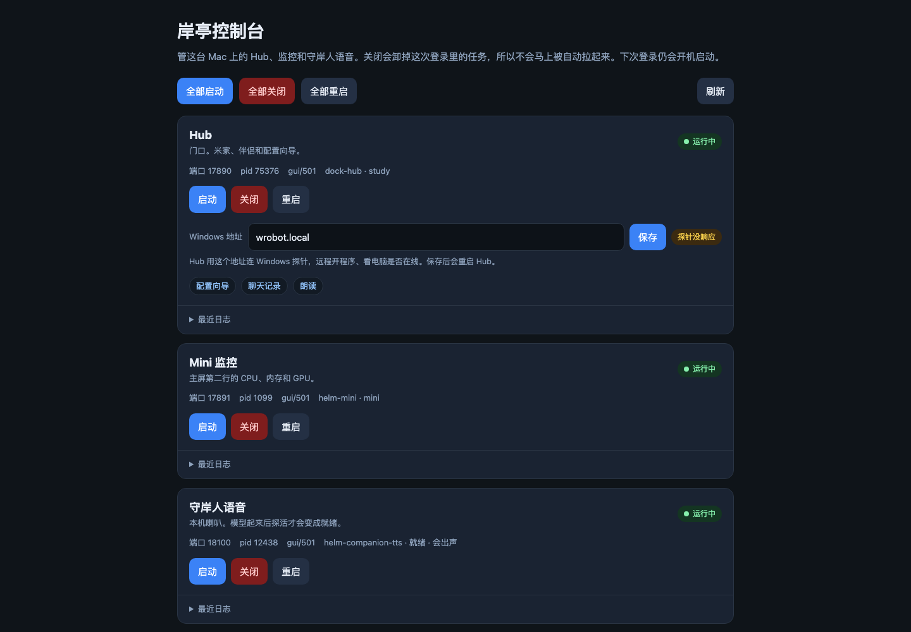

# 岸亭控制台

Mac 本机的服务控制台：浏览器里启停 Hub / Mini 监控 / 守岸人 TTS 三个 LaunchAgent，看健康与日志，确认 Windows 在不在线。只监听 `127.0.0.1`、无鉴权，不要暴露到局域网。



## 跑

```bash
cd console
./dock-console
```

纯 Python 标准库，不需要装依赖。会自动开浏览器；`--port` 换端口（默认 17880），`--no-browser` 不开。Ctrl+C 只退出控制台，不会停服务本身。

## 菜单栏

`menubar/main.swift` 编译成 `岸亭控制台.app`：常驻菜单栏，一键打开控制台各页，下拉直接启停三个服务并显示状态。仓库里提交了编译好的 app，日常双击即可；改了 `main.swift` 后重新编译：

```bash
swiftc menubar/main.swift -o "岸亭控制台.app/Contents/MacOS/ShoretingConsole"
```

## 管理的服务

| id | 名字 | LaunchAgent | 端口 | 安装脚本 |
|---|---|---|---|---|
| `hub` | Hub（门口） | `cn.weiekko.dock-hub` | 17890 | `hub/install-launchd.sh` |
| `mini` | Mini 监控 | `cn.weiekko.helm-mini` | 17891 | `mini/install-launchd.sh` |
| `tts` | 守岸人 TTS | `cn.weiekko.companion-tts` | 18100 | `companion/tts/install-launchd.sh` |

页面上还有 Windows 一栏：改 `hub.yaml` 里 `probe:` 的探针地址（默认端口 17892），并探活确认 Windows 在不在线。

## 测试

```bash
cd console
python3 -m unittest discover -s tests
```
