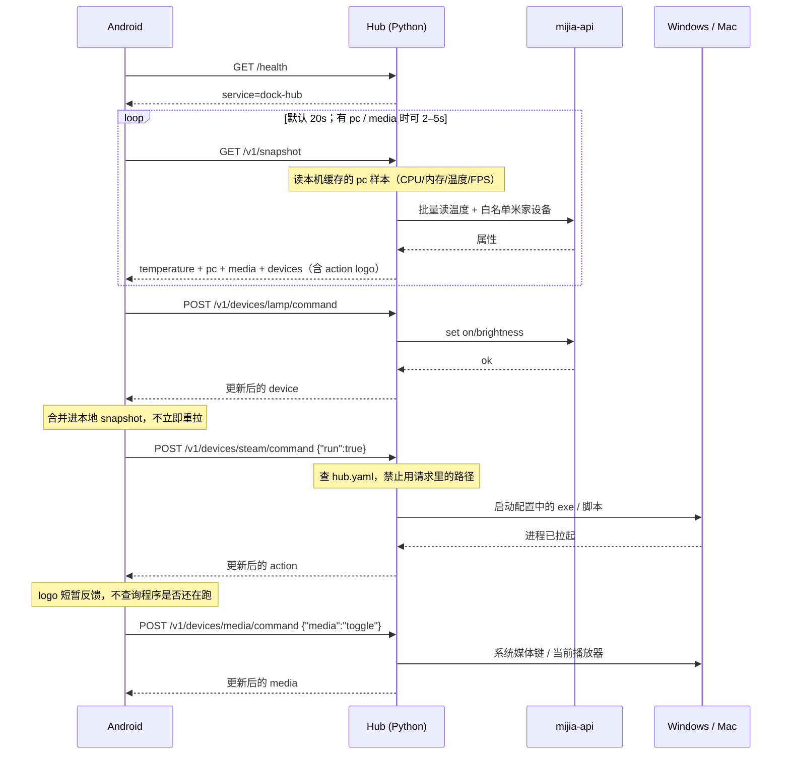

# Shoreting LAN Protocol v1

岸亭安卓客户端与电脑上 Python Hub 的局域网通信契约。

- **安卓**：只实现本文档的客户端。不直连米家，不理解 `did` / `siid` / `piid`，也不知道电脑上要跑哪条命令；电脑性能数字只读 snapshot 里的 `pc`。Mac Mini 监控是另一端口上的 `helm-mini`，不要和 Hub 填反。
- **Hub**（另一名 agent 编写）：在 Mac / Windows 上跑一个简单 Python 脚本，对内调 [mijia-api](https://github.com/Do1e/mijia-api)、采集本机性能、按白名单启动本机程序，可选转本地 LLM；对外只暴露本文档的 HTTP 接口。

本文档讲**为什么、时序、坑**；每个接口的字段定义以 [openapi.yaml](./openapi.yaml) 为准，那是唯一的机器可读契约（当前 20 条 path / 21 个方法）。两边会不会漂不靠记性：`python3 scripts/check_protocol.py` 会拿 `server.py` 的 `do_GET` / `do_POST` 逐条比对，代码里有、文档里没有就非零退出，`hub/tests/test_protocol_doc.py` 也盯着这条。守岸人拓扑与启动顺序见 [companion.md](./companion.md)。

---

## 1. 目标与边界

首版做五件事：

1. 显示一个温度（可选湿度）
2. 控制少数几个已配置的米家设备（开关 / 灯）
3. 主屏 logo：点一下，Hub 在电脑上启动已配置的程序或脚本（Steam、浏览器、一段 `.ps1` / `.bat` 等）
4. 电脑监控：CPU / 内存占用、温度、当前帧率等（只读，挂在 snapshot 的 `pc` 上）
5. 音乐播放控制：上一首 / 播放暂停 / 下一首（挂在 snapshot 的 `media` 上；命令走保留 id `media`）
6. 可选桌面伴侣：短对话（挂在 snapshot 的 `companion` 上；说话走 `POST /v1/companion/chat`，打断走 `POST /v1/companion/stop`）。家里怎么接三台机器见 [companion.md](./companion.md)

不做：电脑唤醒/休眠、摄像头、公网访问、HTTPS、设备实时推送、米家完整设备列表、安卓下发任意命令行、进程列表、磁盘分区管理、远程桌面。

Hub 用配置文件**白名单**暴露米家设备和可启动的程序。没写进配置的，安卓永远看不到，也永远跑不了。电脑监控由 Hub 配置开关；关掉则 snapshot 里 `pc` 为 `null`。播放控制同样由配置开关；关掉则 `media` 为 `null`，且 `POST /v1/devices/media/command` 返回 `404`。

**保留 id：** `media` 不能用作 `devices[].id`。它只表示系统媒体会话。

---

## 2. 传输约定

| 项 | 值 |
|---|---|
| 协议 | HTTP/1.1，无 TLS（仅局域网） |
| 编码 | UTF-8 JSON，`Content-Type: application/json` |
| 默认端口 | `17890` |
| 监听 | `0.0.0.0`（Windows 需放行入站 17890） |
| 版本 | URL 前缀 `/v1`，JSON 里同时带 `"protocol": 1` |
| 时间 | ISO-8601 UTC，例如 `2026-08-15T15:30:01Z` |
| 数字 | JSON number；温度保留一位小数即可 |
| 连接 | keep-alive；空闲 20 秒没请求就断开。Hub 同时最多处理 32 条连接，满了回 `503 busy` |
| 缓存 | `/v1` 一律 `Cache-Control: no-store` |
| 压缩 | JSON 与 HTML 超过 512 字节时，若请求带 `Accept-Encoding: gzip` 就回 `Content-Encoding: gzip`；安卓用 OkHttp 的话默认已带上，不用自己解 |

Hub 必须在启动时打印本机局域网 IP 和端口，方便在安卓里填写，例如：

```
岸亭 Hub v1  http://192.168.1.12:17890
```

### 2.1 鉴权

除 `GET /health` 外，所有请求带：

```http
Authorization: Bearer <token>
```

`token` 是 Hub 配置里的共享密钥，安卓设置页保存一份。不要把米家 `auth.json` 发给手机。

Hub 可以同时认多枚 token：配置里的主 `token`，加上 `tokens:` 列表里按设备分的
几枚（各自带一个 `id`）。任一命中即放行，客户端不需要知道自己是第几枚。

| 情况 | HTTP |
|---|---|
| 缺 header / token 错误 | `401` |
| 任一 token 正确 | 继续处理 |

**吊销**：删掉 `tokens:` 里那一条，然后让 Hub 重载配置（配置向导里点保存即可）。
不用改其他设备，也不用重启。

token 至少 8 个字符 —— 局域网里短 token 等于没有，一个脚本几秒钟就能撞出来。
配对方式仍是明文 HTTP，所以只在可信网段用。

### 2.2 超时（安卓必须遵守）

| 请求 | 超时 |
|---|---|
| `GET /health`、`GET /v1/snapshot` | 5 秒 |
| `POST /v1/devices/{id}/command` | 10 秒 |
| `POST /v1/companion/chat` | 90 秒 |
| `POST /v1/companion/stop` | 2 秒 |
| `POST /v1/companion/announce` | 8 秒 |
| `POST /v1/companion/read` | 立即返回 |
| `POST /v1/companion/read/jobs/{id}/cancel` 等 | 5 秒 |
| `GET /v1/companion/read/jobs` | 5 秒 |
| `GET /v1/companion/audio/{id}` | 90 秒 |

Hub 应在超时前返回。米家过慢则 `502` + `mijia_error`。

### 2.3 轮询

安卓对 `GET /v1/snapshot` 默认每 **20 秒**拉一次。命令成功后用响应体更新本地状态，不要立刻再打 snapshot。

若 snapshot 里 `pc` 或 `media` 非 `null`，安卓可以把轮询缩短到 **2–5 秒**，以便主屏数字和正在播放更跟手。Hub 应在本机高频采样（建议 ≥1 Hz），snapshot 只返回**最新缓存样本**，不要每次 HTTP 都阻塞去扫传感器。

**长轮询（可选，Hub 已实现）**：`GET /v1/snapshot?since=<上次的 seq>&wait=25`。Hub 在状态没变时把请求挂着，`seq` 一变立刻返回，最多挂 `wait` 秒（上限 30，超过按 30 算）。返回体的 `seq` 就是这次的版本号，下次请求带上它。

- 安卓可以完全不用这个参数，行为与普通轮询一致。
- 用了之后，灯被别处开关、伴侣开始说话、PC 上线，手机都能在一瞬间看到，而空闲时几乎没有请求。
- 超时返回是正常情况，不是错误：照常画返回体，再发下一次。
- `seq` 只跟踪 Hub 侧能感知的变化（设备命令、伴侣、媒体、PC 采样、朗读任务）；米家端被别的手段改动，最迟下一轮长轮询超时后同步。

---

## 3. 发现

v1 **主路径**：用户在安卓设置里填 `host`（IP 或主机名）、`port`（默认 17890）、`token`。

Hub 可选注册 mDNS，方便以后自动发现：

| 项 | 值 |
|---|---|
| 类型 | `_dock-hub._tcp` |
| 实例名 | `dock-hub` |
| 端口 | `17890` |
| TXT | `proto=1`（**禁止**把 token 放进 TXT） |

安卓 v1 可以不实现 mDNS。`GET /health` 用来验证地址是不是岸亭 Hub。

---

## 4. 接口一览

字段看 [openapi.yaml](./openapi.yaml)，这里只列「有哪些、谁该打、要不要鉴权」。companion 可关，关掉后这一类全 404。

| 方法 | 路径 | 鉴权 | 用途 |
|---|---|---|---|
| `GET` | `/health` | 否 | 探活、确认是 Hub |
| `GET` | `/v1/snapshot` | 是 | 主屏全部状态（一次拿完） |
| `GET` | `/metrics` | 本机免、跨机要 | Prometheus 文本：首句延迟、轮询耗时、TTS 失败 |
| `POST` | `/v1/devices/{id}/command` | 是 | 控制一个设备，或触发一个 logo 动作 |
| `GET` | `/v1/weather` | 是 | Hub 代取天气（手机可能只有局域网）；响应顺带 `pm25`（F14，可缺省） |
| `GET` | `/v1/photos/{id}` | 是 | 回忆相框（F37）：一张照片的原图。名单走 snapshot.photos，带 ETag/304；id 只认 basename，穿越一律 404 |
| `POST` | `/v1/telemetry` | 是 | Windows 探针上报 CPU / GPU / 进程名 |
| `POST` | `/v1/power` | 是 | Hub → 探针：`{"power": "shutdown"\|"sleep"\|"lock"}`（F21）。探针在本机执行：关机 `/t 5`、锁屏、睡眠。危险动作的二次确认在伴侣语音侧，协议层不拦 |
| `POST` | `/v1/companion/chat` | 是 | 桌面伴侣一轮对话（配置关闭则 404） |
| `POST` | `/v1/companion/stop` | 是（本机可免） | 打断当前说话，立刻停 Mini 喇叭 |
| `POST` | `/v1/companion/announce` | 是 | 让守岸人说一句（微信侧路；安卓不用打） |
| `POST` | `/v1/companion/read` | 是（本机可免） | 朗读：播放或排队生成 wav |
| `GET` | `/v1/companion/read/jobs` | 是（本机可免） | 朗读任务列表。**安卓不要打** |
| `POST` | `/v1/companion/read/jobs/{id}/{action}` | 是（本机可免） | `cancel` / `delete` / `replay` 一个朗读任务。**安卓不要打** |
| `GET` | `/v1/companion/audio/{id}` | 是（本机可免） | 伴侣 wav（`audio_id` 为空或关闭则不要打） |
| `GET` | `/v1/companion/chats` | 是（本机可免） | 对话原文列表。控制台的聊天记录页在用 |
| `GET`/`POST` | `/v1/companion/books` | 是（本机可免） | 睡前朗读书架 / 上传一本 txt。**安卓不要打** |
| `GET` | `/v1/companion/books/{id}` | 是（本机可免） | 打开一本书：章节索引 + 书签位置。**安卓不要打** |
| `GET` | `/v1/companion/books/{id}/chapter/{index}` | 是（本机可免） | 一章的正文。**安卓不要打** |
| `POST` | `/v1/companion/books/{id}/{action}` | 是（本机可免） | `play` / `pause` / `bookmark`。**安卓不要打** |
| `GET` | `/v1/companion/story` | 是（本机可免） | 睡前朗读进度与定时。**安卓不要打** |
| `POST` | `/v1/companion/story/timer` | 是（本机可免） | 睡前定时 0 / 15 / 30 / 45 / 60 分钟。**安卓不要打** |
| `POST` | `/v1/scenes/{id}` | 是 | 一次开关一组设备（配置里的场景） |
| `POST` | `/v1/leave` | 是 | 离家总控：能关的全关，报告没关掉的（F18） |
| `POST` | `/v1/presence` | 是 | 在场上报：手机连上 / 离开家里 WiFi（F25） |
| `POST` | `/v1/at-desk` | 是 | 在桌上报：摄像头本地检测的「有人/没人」（F24） |

没有单独的「读温度」「读电脑性能」「跑脚本」「读正在播放」接口。米家温度、logo、电脑监控、正在播放、伴侣是否就绪都在 snapshot 里；点击 logo 和播放键走同一个 command；说话走 companion/chat，再喊唤醒词打断走 companion/stop，声音走 companion/audio。

---

## 5. 数据模型

### 5.1 设备类型

| `type` | 可写字段 | snapshot 必带 | snapshot 可选 |
|---|---|---|---|
| `switch` | `on` | `on` | — |
| `light` | `on`，`brightness` | `on` | `brightness`（1–100 整数） |
| `action` | `run`（必须为 `true`） | — | `icon`（短名），`last_run_at` |

`id` 由 Hub 配置决定，稳定、URL 安全，例如 `lamp`、`desk-plug`、`steam`。安卓只认这个 id。

`action` 是「点一下就跑」：主屏画成 logo，没有开关状态。真正的可执行文件 / 脚本路径**只写在 Hub 配置里**，禁止出现在 HTTP 响应或请求里。

`icon` 是短名。安卓用内置 [Remix Icon](https://remixicon.com/) 渲染；没有或不认识则画名称首字。Hub **不**提供图标文件。

安卓 v1 已映射（不区分大小写）：`steam`、`chrome`、`vscode` / `code`、`cursor`、`terminal` / `cmd` / `shell`、`folder`、`music`、`computer` / `pc` / `desktop`。

未使用的字段**不要出现**（不要发 `brightness: null`，`action` 不要发 `on`）。

### 5.2 Hub 登录态 `hub.mijia`

| 值 | 含义 | 安卓怎么做 |
|---|---|---|
| `ok` | 米家可用 | 正常显示 |
| `login_required` | 需要在电脑上扫码 | 主屏提示「请在电脑上扫码登录米家」 |
| `error` | 已登录但调用失败 | 显示 `hub.message`，沿用上次温度 |

`pc`（电脑监控）**不依赖**米家。`hub.mijia` 为 `login_required` 时，`pc` 仍应照常返回。

### 5.3 电脑监控 `pc`

只读。挂在 snapshot 顶层，**不是** `devices[]` 里的一项，也没有 command。

| 字段 | 必填 | 说明 |
|---|---|---|
| `online` | 是 | 本轮采样是否成功。Hub 进程在但采样失败 → `false` |
| `updated_at` | 是 | 该样本采集时间（UTC）。离线时给**最后一份样本**的时间，不要打当前时间 |
| `cpu` | `online` 时建议有 | 见下表 |
| `memory` | `online` 时建议有 | 见下表 |
| `gpu` | 否 | 整段省略 = 无独立 GPU / 读不到 |
| `fps` | 否 | 当前合成/游戏帧率；读不到则**省略该键** |

`cpu`：

| 字段 | 必填 | 说明 |
|---|---|---|
| `percent` | 是 | 整机 CPU 占用，0–100 |
| `temp_celsius` | 否 | 封装/核心温度；读不到则省略 |

`memory`：

| 字段 | 必填 | 说明 |
|---|---|---|
| `percent` | 是 | 已用 / 总量 × 100，0–100 |
| `used_gb` | 否 | 已用，GiB，一位小数即可 |
| `total_gb` | 否 | 总量，GiB |

`gpu`（整段可选）：

| 字段 | 必填 | 说明 |
|---|---|---|
| `percent` | 建议有 | GPU 占用 0–100；没有就省略该键 |
| `temp_celsius` | 否 | GPU 温度 |
| `name` | 否 | 短名，如 `RTX 4070`，给安卓小字展示 |
| `vram_percent` | 否 | 显存占用 0–100 |
| `vram_used_gb` / `vram_total_gb` | 否 | 显存用量 |

`fps`：JSON number（整数优先）。含义是「当前画面帧率」——全屏游戏、PresentMon / RTSS 一类源，或桌面合成帧率均可；Hub 选一种写进配置，**不要**在响应里塞采集器路径。

规则：

- 配置关闭监控 → snapshot 的 `pc` 为 `null`（键保留，值为 `null`，与 `temperature` 一致）
- `online: false`：可只带 `online` + `updated_at`，其余省略；安卓显示「电脑监控离线」并沿用上次数字（若有）
- 百分比用 number，保留一位小数即可；不要发字符串
- 未使用的可选键**不要出现**（不要 `fps: null`）
- 禁止返回进程列表、磁盘路径、用户名、完整 PCI ID 等敏感细节

### 5.4 播放控制 `media`

系统正在播放的会话。挂在 snapshot 顶层，**不是** `devices[]` 里的一项。命令仍走 `POST /v1/devices/media/command`（保留 id `media`）。

| 字段 | 必填 | 说明 |
|---|---|---|
| `online` | 是 | 能否向系统媒体会话发键。Hub 进程在即可为 `true` |
| `playing` | 是 | 是否正在播放。读不到曲目时仍要给这个布尔值（可用上次命令的乐观值） |
| `updated_at` | 是 | 播放状态**最后一次变化**的时间（UTC）；状态没变就保持不变 |
| `title` | 否 | 曲名；读不到则**省略该键** |
| `artist` | 否 | 艺人；读不到则省略 |
| `app` | 否 | 短名，如 `Music`、`Spotify`；不要发可执行路径 |

规则：

- 配置关闭 → snapshot 的 `media` 为 `null`（键保留，值为 `null`）
- 未使用的可选键**不要出现**
- 不依赖米家。`hub.mijia` 为 `login_required` 时，`media` 仍应照常返回
- 禁止返回文件路径、窗口标题整串、歌词

命令 body **只许**下面三种之一：

```json
{"media": "toggle"}
{"media": "next"}
{"media": "previous"}
```

**200** 返回与 snapshot.`media` 同形的对象（不是 Device）。安卓用它替换本地 `media`。

### 5.5 桌面伴侣 `companion`

本地大模型短对话。挂在 snapshot 顶层，**不是** `devices[]` 里的一项。说话走 `POST /v1/companion/chat`，不要复用 devices/command。

| 字段 | 必填 | 说明 |
|---|---|---|
| `ready` | 是 | 大脑（LLM）现在能否回答。Ollama 守护进程活着则为 `true` |
| `voice` | 是 | Mini TTS `/health` 探活且 `ready`。没配 `tts.base_url` 或连不上则为 `false` |
| `speaking` | 是 | Hub 正在向 TTS 提交或拉取音频时为 `true`。`POST /v1/companion/stop` 后应变回 `false` |
| `timer` | 是 | 番茄钟 / 正计时状态（F9），没有就是 `null`。见下 |

`timer` 两种形态：

- 倒计时：`{"mode": "timer", "label": "计时", "total_sec": 1500, "seconds_left": 1430}`——到点 Hub 开口说「到时间了。」并把它清成 `null`；安卓在右上角画细环
- 正计时：`{"mode": "stopwatch", "label": "正计时", "seconds": 95}`——「开始正计时」起表，「停止计时」落表，她说「记了 X 分钟」

规则：

- 配置关闭或整段删掉 → snapshot 的 `companion` 为 `null`（键保留，值为 `null`）
- 不依赖米家。`hub.mijia` 为 `login_required` 时，`companion` 仍应照常返回
- 禁止把模型路径、prompt、API key、参考音频路径放进 snapshot
- 安卓只发用户这句话。Hub **不要**为 chat 先打 snapshot。灯/开关若要口头操作：模型写 `ACTION: {id}.on|off`，启动项写 `ACTION: {id}.run`，或用户话里带「关灯 / 开空调 / 关掉加湿器 / 启动无畏契约」时 Hub 兜底。米家登录后，账号里带 on 类属性的设备都会进口头技能，不必写进主屏 `hub.yaml`。口令可绑到这些 id，持久化到 `companion-aliases.yaml`。不要把当前开没开写进提示词。

### 5.6 手机端外观 / 电源 / 天气 / 布局 `phone`

这几项本来是手机自己的 DataStore（设置页「外观与字体 / 电源」），Hub 存一份权威副本下发，好让控制台能改。挂在 snapshot 顶层，**不是** `devices[]` 里的一项。

| 字段 | 必填 | 说明 |
|---|---|---|
| `rev` | 是 | 外观版本号，整数，只增不减。控制台每保存一次外观 +1 |
| `tile` | 是 | 方块外观：`{style, opacity, corner}` |
| `tile.style` | 是 | `frost` / `ink` / `solid` / `line` |
| `tile.opacity` | 是 | 0–100，百分比 |
| `tile.corner` | 是 | 8–32，dp |
| `type` | 是 | 字体与字号：`{font, clock, stats, tile, chip}` |
| `type.font` | 是 | `system` / `sans` / `serif` / `mono` / `inter` / `outfit` / `jetbrains` / `smiley` |
| `type.clock` | 是 | 时钟缩放百分比，60–140 |
| `type.stats` | 是 | 监控数字字号，11–32 |
| `type.tile` | 是 | 按钮字号，11–22 |
| `type.chip` | 是 | 底部字号，11–22 |
| `screen.keep_on` | 是 | 插电常亮（不因插拔电源锁屏） |
| `screen.sleep_sec` | 是 | 电脑关机后多久压暗，15–600 秒 |
| `weather.enabled` | 是 | 主屏是否显示天气 |
| `weather.city` | 是 | 中文城市名，Hub 代取天气时用它 |
| `layout` | 否 | 主屏布局，见下；没在控制台存过布局就不带这个键 |
| `layout.rev` | 是 | 布局自己的版本号，**与外观的 `rev` 各走各的** |
| `layout.modules` | 是 | 槽位 id → `{x, y, w, h, visible, chrome}`，全是 0–1 的画布比例 |

`layout` 规则：

- 槽位 id 是 APK 里 `ModuleCatalog` 的键（`Clock` / `Pc` / `Win0…2` / `Device0…1` / `Media` / `Weather` / `Indoor`）。Hub 不校验名单，不认识的槽位安卓渲染时自然跳过
- `w` 或 `h` 小于 0.05 是**占位矩形**：位置用默认值，只认 `visible` / `chrome`。安卓存回 DataStore 前会把这类矩形归零
- 安卓记着 `appliedLayoutRev`，`layout.rev` 变大才写 DataStore；手机上手动拖过的布局同样不会被轮询顶回去
- 保存外观不动布局的 rev，保存布局也不动外观的 rev

通用规则：

- **`rev` 没变大就别动**。安卓记着自己套用到哪一版（`HubPreferences.appliedPhoneRev`），只有看到更大的 `rev` 才覆盖本地值。这样在手机上手动调过的字号、城市不会被每轮轮询顶回去
- 没配过（`phone.rev == 0` 且 `layout.rev == 0`）→ snapshot 里**不带这个键**，别发一个全默认值的对象
- 越界数值安卓按上表夹到边界，不报错也不崩；枚举不认识的（例如 `style: "glass"`）退回默认值
- 这里只放外观和开关，**不要**塞 token、路径、日志

视频背景不在这条链路上：手机自己起了一个背景管理页（`BackgroundServer`，端口 **17920**，用同一个 Hub Token 换 cookie），控制台的「视频背景」直接连它做列表 / 上传 / 选中 / 删除，`GET /api/layout` 也在这上面（网页布局编辑器读手机现状用；旧 APK 没有这个接口）。手机没连上 Wi-Fi 时这块读不出来，属于正常现象。

---

## 6. 接口定义

### 6.1 `GET /health`

无鉴权。用来探测「这台机器是不是岸亭 Hub」。

**200**

```json
{
  "ok": true,
  "service": "dock-hub",
  "protocol": 1,
  "name": "study"
}
```

| 字段 | 说明 |
|---|---|
| `ok` | 进程活着即为 `true`（即使米家未登录） |
| `service` | 固定 `"dock-hub"` |
| `protocol` | 固定 `1` |
| `name` | Hub 配置里的房间/电脑名，给安卓设置页展示 |

非岸亭 Hub 不会返回这个形状。安卓连上后应检查 `service == "dock-hub"` 且 `protocol >= 1`。

---

### 6.2 `GET /v1/snapshot`

主屏唯一读接口。

**200**（米家正常）

```json
{
  "protocol": 1,
  "hub": {
    "name": "study",
    "mijia": "ok",
    "message": null
  },
  "temperature": {
    "id": "desk",
    "name": "书桌",
    "celsius": 26.4,
    "humidity": 53,
    "updated_at": "2026-08-15T15:30:01Z",
    "online": true
  },
  "pc": {
    "online": true,
    "updated_at": "2026-08-15T15:30:01Z",
    "cpu": {
      "percent": 24.1,
      "temp_celsius": 61.2
    },
    "memory": {
      "percent": 47.5,
      "used_gb": 15.2,
      "total_gb": 32.0
    },
    "gpu": {
      "name": "RTX 4070",
      "percent": 12.0,
      "temp_celsius": 52.0,
      "vram_percent": 28.0,
      "vram_used_gb": 3.4,
      "vram_total_gb": 12.0
    },
    "fps": 144
  },
  "media": {
    "online": true,
    "playing": true,
    "title": "Night Drive",
    "artist": "Demo",
    "app": "Music",
    "updated_at": "2026-08-15T15:30:01Z"
  },
  "companion": {
    "ready": true,
    "voice": false,
    "speaking": false
  },
  "devices": [
    {
      "id": "lamp",
      "name": "台灯",
      "type": "light",
      "online": true,
      "on": true,
      "brightness": 60
    },
    {
      "id": "monitor-plug",
      "name": "显示器",
      "type": "switch",
      "online": true,
      "on": true
    },
    {
      "id": "steam",
      "name": "Steam",
      "type": "action",
      "online": true,
      "icon": "steam"
    }
  ],
  "scenes": [
    {"id": "bedtime", "name": "晚安"},
    {"id": "work", "name": "干活"}
  ]
}
```

**200**（未登录：仍然 200，用 `hub.mijia` 表达，避免安卓把「没登录」当成网络错误。`action` 与 `pc` 不依赖米家，未登录时仍要返回。）

```json
{
  "protocol": 1,
  "seq": 41,
  "hub": {
    "name": "study",
    "mijia": "login_required",
    "message": "请在运行 Hub 的电脑上扫码登录米家"
  },
  "temperature": null,
  "pc": {
    "online": true,
    "updated_at": "2026-08-15T15:30:01Z",
    "cpu": { "percent": 8.0 },
    "memory": { "percent": 41.0, "used_gb": 13.1, "total_gb": 32.0 },
    "fps": 60
  },
  "devices": [
    {
      "id": "steam",
      "name": "Steam",
      "type": "action",
      "online": true,
      "icon": "steam"
    }
  ]
}
```

| 字段 | 规则 |
|---|---|
| `seq` | 状态版本号，整数，只增不减。长轮询拿它当 `since`；不带 `since`/`wait` 时忽略即可 |
| `temperature` | 未配置、未登录、读失败时为 `null` |
| `temperature.humidity` | 传感器没有湿度时**省略该键** |
| `temperature.celsius` | 摄氏度，number |
| `pc` | 未在配置中开启时为 `null`；开启后见 §5.3 |
| `media` | 未在配置中开启时为 `null`；开启后见 §5.4 |
| `devices` | 只包含配置白名单；顺序与配置文件一致（安卓按此顺序画按钮 / logo） |
| `devices[].online` | `switch` / `light`：`false` 时仍返回上次 `on` / `brightness`（若有），按钮禁用。`action`：配置的程序/脚本文件不存在时为 `false`，logo 禁用 |
| `devices[].on` | `switch` / `light`：开关状态。`action`：对应进程是否正在运行（默认看 exe 文件名；可用配置 `process` 覆盖） |
| `devices[].icon` | 仅 `action`。短名；安卓 Remix Icon 映射见 §5.1。没有或不认识则画名称首字 |
| `devices[].last_run_at` | 仅 `action`，可选。上次成功拉起的 UTC 时间 |
| `scenes` | 配置里的场景，`[{id, name}]`，顺序同配置；没配就是空数组 |
| `phone` | 控制台改的手机端外观 / 电源 / 天气 / 布局，见 §5.6；没在控制台改过（两个 rev 都是 0）时**不带这个键** |
| 未登录时的 `devices` | 去掉所有米家设备，**保留**全部 `action`，以及 `ws2812` 灯带（对安卓仍报 `type: light`） |

Hub 应对白名单设备**批量**读属性，不要一台一台串行请求米家。`pc` 用本机缓存，不要拖慢米家批量读。

---

### 6.3 `POST /v1/devices/{id}/command`

`{id}` 是 snapshot 里的设备 id。Body 只带要改的字段（部分更新）。

开灯并设亮度：

```http
POST /v1/devices/lamp/command
Authorization: Bearer <token>
Content-Type: application/json

{"on": true, "brightness": 80}
```

关灯：

```json
{"on": false}
```

只调亮度（灯已开）：

```json
{"on": true, "brightness": 40}
```

关 `switch`：

```json
{"on": false}
```

点主屏 Steam logo（Hub 在 Windows 上启动配置里的程序，例如 `steam.exe` 或一段脚本）：

```http
POST /v1/devices/steam/command
Authorization: Bearer <token>
Content-Type: application/json

{"run": true}
```

安卓**只许**发 `{"run": true}`。不要发路径、参数、脚本内容。

播放 / 暂停（保留 id `media`，响应是 `media` 对象）：

```http
POST /v1/devices/media/command
Authorization: Bearer <token>
Content-Type: application/json

{"media": "toggle"}
```

下一首：`{"media": "next"}`。上一首：`{"media": "previous"}`。

**200**：返回该设备的最新对象（与 snapshot 里单项同形），安卓用它替换本地列表中的那一项。 `media` 命令除外，见 §5.4。

```json
{
  "id": "lamp",
  "name": "台灯",
  "type": "light",
  "online": true,
  "on": true,
  "brightness": 80
}
```

`action` 的 **200**（拉起即返回，没有 `on`）：

```json
{
  "id": "steam",
  "name": "Steam",
  "type": "action",
  "online": true,
  "icon": "steam",
  "last_run_at": "2026-08-15T15:30:01Z"
}
```

**约定**

- 空 body `{}` → `400` `bad_request`
- `switch` 收到 `brightness` 或 `run` → `400` `unsupported`
- `light` 收到 `run` → `400` `unsupported`
- `action` 收到 `on` / `brightness` / `media`，或 `run` 不是 `true` → `400` `unsupported`
- `switch` / `light` 收到 `media` → `400` `unsupported`
- 保留 id `media` 收到 `on` / `run` / `brightness` → `400` `unsupported`
- `media` 未开启 → `404` `not_found`
- `light` 只改 `brightness` 且当前是关的：Hub 应开灯并设亮度（安卓也可以同时传 `"on": true`）
- `brightness` 必须是 1–100 的整数，否则 `400`
- 设备离线 / `action` 的程序文件不存在 → `409` `offline`
- 未知 id → `404` `not_found`
- 米家未登录：`switch` / `light` → `503` `login_required`；`action` 与 `media` **照常执行**
- 写成功但立刻回读失败：仍 `200`，把请求里的目标状态填进响应，并尽量设 `online: true`
- `action` 默认拉起进程后立刻返回 `200`，**不等** GUI 程序退出。响应里带上 `icon`（若有），可带 `last_run_at`
- 进程拉起失败（权限、可执行文件损坏、PowerShell 报错且 `wait: true`）→ `502` `action_error`

同一 id 的命令 Hub 应串行处理，避免米家并发写打架，也避免同一个 logo 被连点启动两份程序。

### 6.4 `POST /v1/companion/chat`

一轮用户说话。需要 token。配置未开启 companion → `404` `not_found`。

```http
POST /v1/companion/chat
Authorization: Bearer <token>
Content-Type: application/json

{"text": "晚上好。"}
```

| 字段 | 必填 | 说明 |
|---|---|---|
| `text` | 是 | 用户这句话，UTF-8，去掉首尾空白后不能为空 |
| `speaker` | 否 | F5 声纹：手机本地比对出的称呼（如「妈妈」），没认出来就不带这个字段。音频不出设备，Hub 只把它带进提示词和对话记录，超过 12 字截断 |
| `weather` | 否 | 一期可忽略。二期给 Hub 室外天气，形状不在此冻结 |

**200**

```json
{
  "text": "晚上好，漂泊者。岸边很安静。",
  "audio_id": null
}
```

| 字段 | 说明 |
|---|---|
| `text` | 给字幕和 TTS 的正文。1–3 句。不要把 thinking 链放进来 |
| `audio_id` | 默认 `null`：声音从 Mini 本机播放，不把 wav 交给手机。仅当 `companion.tts.deliver: true` 且合成成功时才为 id（`A-Za-z0-9._-`），非空时可立刻 `GET /v1/companion/audio/{id}` |

**错误**

- 空 `text` / 缺字段 → `400` `bad_request`
- companion 关闭 → `404` `not_found`
- LLM 不可达或超时 → `502` `companion_unavailable`

Hub 应在超时前返回。4B 关思考仍慢则 `502`，不要让安卓一直转。默认 `tts.deliver` 为 false：Hub 流式读 Ollama，**每写出一句（。！？）就 cue Mini TTS**，chat 仍等全文再 `200`。TTS 侧同轮各句接到同一播放队列，不要互相打断；只有 `POST /v1/companion/stop` 才停喇叭。TTS 失败**不要**把整段打成 502。安卓再喊「小岸」时打 stop，不要等这一轮 chat 结束。

对方明确要开关灯/空调/其它带开关的米家设备，或启动白名单程序时，Hub 可执行 on/off 或 `run`（模型 `ACTION:` 行或口语兜底）。米家账号里能开关的设备在登录后自动可口头操作，不必出现在主屏。不要执行未绑定的 id，闲聊不要当命令。

### 6.5 `GET /v1/companion/audio/{id}`

需要 token（本机直连可免）。`id` 只允许 `A-Za-z0-9._-`。仅 `tts.deliver: true` 时 chat 才会把 wav 交给手机；朗读页生成的文件也会落在这里。**安卓不要直连 :18100**。默认 chat 不缓存，本接口 404。

合成发生在 `POST /v1/companion/chat` 或 `POST /v1/companion/read` 里；本接口只返回已缓存或已落盘的 wav，不再向 TTS 要一遍。

没有这段、或 `id` 不认识 → `404`。没配 TTS 时 chat 的 `audio_id` 为 `null`，安卓不要打这个接口。

`?download=1` 时带 `Content-Disposition: attachment`，给浏览器下载。安卓不要带这个参数。

```http
GET /v1/companion/audio/a1b2c3d4e5f6
Authorization: Bearer <token>
```

**200** `Content-Type: audio/wav`

### 6.6 `POST /v1/companion/stop`

需要 token。配置未开启 companion → `404` `not_found`。

再喊「小岸」时立刻打这个接口：停 Mini 喇叭、丢掉还没开口的旧轮 TTS。请求体可空。安卓不要直连 `:18100`。

```http
POST /v1/companion/stop
Authorization: Bearer <token>
```

**200**

```json
{"ok": true}
```

TTS 没配或 Mini 暂时连不上仍 `200`（字幕和唤醒不受影响）。进行中的 `chat` 若大脑还没返回，回来后不要再 cue TTS。

### 6.7 `POST /v1/companion/announce`

需要 token。配置未开启 companion → `404` `not_found`。

给**外部脚本 / 微信机器人**用：让守岸人在书桌喇叭说 1～3 句，**不走**对话调度。安卓不要打这个接口。

```http
POST /v1/companion/announce
Authorization: Bearer <token>
Content-Type: application/json

{"text": "灯已经关了。"}
```

**200** 形状与 `chat` 相同（`text` + `audio_id`）。空 `text` → `400`。

### 6.8 `POST /v1/companion/read` · `GET /v1/companion/read/jobs`

给 **控制台的朗读页** 用：贴一段文字，预估时长后在 Mini 喇叭播放，或排队生成一份 24 kHz 单声道 WAV 供下载。**安卓不要打**。配置未开启 companion → `404`。本机可免 token，局域网与 `/chats` 相同。

一次最多 8000 字。预估按约 4 字/秒，不调模型。`mode` 为 `play` 或 `file`，**都立刻入队**；`play` 在后台 cue Mini，`file` 后台合成、不播喇叭。短句会先合并到接近克隆参考的长度再送 TTS。

```http
POST /v1/companion/read
Authorization: Bearer <token>
Content-Type: application/json

{"text": "今晚睡前，我读一点给你听。", "mode": "file"}
```

**200**（`file` 刚提交时常是 `queued`；短稿可能已经 `done`）

```json
{
  "id": "a1b2c3d4e5f6",
  "job_id": "a1b2c3d4e5f6",
  "text": "今晚睡前，我读一点给你听。",
  "mode": "file",
  "status": "queued",
  "chars": 13,
  "estimate_sec": 3,
  "chunks": 1,
  "done": 0,
  "preview": "今晚睡前，我读一点给你听。",
  "audio_id": null,
  "duration_sec": null,
  "bytes": null,
  "filename": null,
  "error": null,
  "format": "audio/wav"
}
```

`status`：`queued` | `running` | `done` | `error`。`play` 完成时 `status=done`，`audio_id` 为 `null`。`file` 完成后用 `GET /v1/companion/audio/{id}?download=1` 下载。wav 写在 Hub 配置目录的 `reads/` 下。

```http
GET /v1/companion/read/jobs
Authorization: Bearer <token>
```

**200** `{ "items": [ /* 与上同形，不含全文 text，最新在前 */ ] }`

任务操作（同样本机可免，**安卓不要打**）：

```http
POST /v1/companion/read/jobs/{id}/cancel
POST /v1/companion/read/jobs/{id}/replay
POST /v1/companion/read/jobs/{id}/delete
```

`cancel` 停下排队或正在跑的任务；`replay` 用存下的稿再 cue Mini；`delete` 从列表拿掉并删掉对应 wav。控制台朗读页的「停止」走 `POST /v1/companion/stop`。


### 6.9 睡前朗读

书放在 Hub 配置目录的 `books/`。这些路由**安卓不要打**。鉴权：本机免 Token，局域网要 Token。伴侣未开启时 `404`。

`GET /v1/companion/books` 只返回文件名、大小、修改时间、`current_id` 和 `timer_min`，不返回正文。

`POST /v1/companion/books` 的正文是 txt 原字节，文件名在请求头 `X-Filename`（百分号编码的 UTF-8）。超过 32MB 拒绝。同名覆盖。

`GET /v1/companion/books/{id}` 返回章目录（`index`、`title`、`volume`、`start`、`end`）、书签、编码和 `problem_label`。`GET /v1/companion/books/{id}/chapter/{index}` 只返回这一章的正文。

`POST /v1/companion/books/{id}/play` 从书签接着读；JSON 可以带 `offset` 用来跳章。正在读时再次调用是跳转，倒计时不重新给满。`POST /v1/companion/books/{id}/pause` 停喇叭并把书签留在当前段开头。`POST /v1/companion/books/{id}/bookmark` 只在没在读时移动书签。

`GET /v1/companion/story` 返回是否在读、字偏移、章序号、当前句、`timer_min`、`timer_remaining_sec`、`stopped_by`。`POST /v1/companion/story/timer` 的 `minutes` 只能是 `0`、`15`、`30`、`45`、`60`。`0` 是关。默认 30 分钟。暂停会冻住剩余时间。到点或读完清掉倒计时，下一次播放才重新给满。

页头停止仍是 `POST /v1/companion/stop`。故事正在读时，这次停止同时留下书签。

### 6.10 `POST /v1/scenes/{id}`

一次动一组设备。`{id}` 取自 snapshot 的 `scenes[].id`，场景本身写在 `hub.yaml` 的 `scenes` 里（用户自己配，客户端不要写死）。body 随意，发 `{}` 就行。

```http
POST /v1/scenes/bedtime
Authorization: Bearer <token>
Content-Type: application/json

{}
```

**200**

```json
{
  "id": "bedtime",
  "name": "晚安",
  "ok": true,
  "actions": [
    {"id": "lamp", "on": false, "ok": true},
    {"id": "desk-lamp", "on": true, "brightness": 35, "ok": true},
    {"id": "steam", "run": true, "ok": true}
  ],
  "said": true
}
```

- 顺序固定：先 `on` 的设备，再带亮度的，最后 `off` 的，然后是 `run` 的启动项；一台一台来，不并发。
- 场景可以带 `run`（一键工作区）：启动项 id 列表，复用 `/v1/devices/{id}/command` 的 `run` 那条路；单个启动失败不影响其余，返回项是 `{"id": "steam", "run": true, "ok": false, "code": "offline", "message": "..."}`。
- 单个设备失败不影响其余。整体 `ok` 是 `false`，失败那一项带 `code` / `message`，取值同 §7。
- `said` 只表示「Hub 正在让伴侣念场景里那句话」，说话是异步的，接口不等 TTS。伴侣关着或场景没写 `say` 就是 `false`。
- 未知 id → `404` `not_found`。米家未登录时米家设备按 §7 报 `login_required`，不影响 `ws2812`。
- 安卓可以在主屏放一排场景按钮，点了就打这个接口，然后照常用响应里的 `actions` 打补丁，或者等下一轮 snapshot。

### 6.11 `POST /v1/leave`

「我出门了」：把所有能开关的设备（灯 / 插座 / 灯带）一台一台关掉，单个失败不影响其余，然后告诉你**没关掉的**。启动项是「开」的东西、传感器没有开关，都不碰。body 随意，发 `{}` 就行。语音侧说「我出门了」走同一条 `leave_home()`。

```http
POST /v1/leave
Authorization: Bearer <token>
Content-Type: application/json

{}
```

**200**

```json
{
  "ok": false,
  "actions": [
    {"id": "ceiling", "on": false, "ok": true},
    {"id": "desk-lamp", "on": false, "ok": false, "code": "offline", "message": "米家设备离线"}
  ],
  "left": ["desk-lamp"],
  "spoken": "台灯没关上，其他的都关了。"
}
```

- `left` 是没关掉的设备 id 列表；全关掉就是空数组，`ok` 为 `true`。
- `spoken` 是她要说的那句话：没关掉的最多点两名，多了念不完。接口本身不说话（语音侧由伴侣把这句话当回复说出来），安卓自己显示即可。
- 一个能开关的设备都没有时 `ok` 为 `false`，`spoken` 是「家里没有归我管的灯和插座。」。

---

### 6.12 `POST /v1/presence`

在场上报（F25）：安卓端监听网络变化，手机**连上家里 WiFi** 报 `home`，**断开 10 分钟**报 `away`。Hub 只记状态并在 snapshot 里带出；`away → home` 的那一刻她按主动播报的规矩说一句「回来了」（受 `proactive.enabled`、免打扰时段、每日配额管——配额用完或免打扰就不说，不补）。`unknown → home`（Hub 刚重启的第一报）不问候，免得每次重启都「欢迎回家」。同一状态重复上报幂等，不算状态变化。

不做成「欢迎回家」那种假热情：默认就一句「回来了。」，之后只在她有信息时补一句（那是早间简报 / 周报的事）。

```http
POST /v1/presence
Authorization: Bearer <token>
Content-Type: application/json

{"state": "home"}
```

**200**

```json
{
  "ok": true,
  "state": "home",
  "previous": "away",
  "said": "回来了。"
}
```

- `state` 只有 `home` / `away` 两个值，其他值 400。
- `previous` 是上一个状态，第一次上报是 `null`。
- `said` 是这次她实际说出口的话；没说就是 `null`（被配额 / 免打扰 / 主动播报关着拦下），不重试、不补发。
- 掉线误报由安卓侧负责去抖（连上才算 home，断开满 10 分钟才算 away），Hub 不做第二次判断。

---

### 6.13 `POST /v1/at-desk`

在桌上报（F24）：安卓摄像头**本地**跑人脸检测，只产出「有人 / 没人」布尔值送到电源侧——有人亮屏、离座 5 分钟压暗。画面不出设备、不存储，协议里也没有任何图像字段。

离座满 5 分钟后回来（`away → present` 的边沿）她按主动播报的规矩说一句（`proactive.enabled`、免打扰、每日配额照走，被拦下不补）；坐下→离开只记状态不说话。`away_sec` 是这次离座的秒数，安卓去抖、Hub 用它把关闸复算一遍（不足 300 秒不问候——门口取个快递不换来一句「回来了」）。

```http
POST /v1/at-desk
Authorization: Bearer <token>
Content-Type: application/json

{"present": true, "away_sec": 312}
```

**200**

```json
{
  "ok": true,
  "present": true,
  "away_sec": 312,
  "said": "回来了。"
}
```

- `present` 必须是布尔值，其他类型 400。
- `away_sec` 可省（按 `0` 算）；Hub 复算离座时长，`present: true` 且离座满 5 分钟才可能问候。
- `said` 是这次她实际说出口的话；没说就是 `null`（被配额 / 免打扰 / 主动播报关着拦下），不重试、不补发。
- 同一状态重复上报幂等；`present: false` 只记状态，不说话。
- snapshot 的 `at_desk` 带出 `{state: present|away, since}`，第一次上报前为 `null`。

---

### 6.14 `GET /metrics`

给 Prometheus 抓的纯文本指标。**安卓不打**，它不是协议面的一部分，改起来也不受 v1 约束。

鉴权：本机直连免 Token；跨机抓要带 `Authorization: Bearer <token>`。
不设这个例外的话，同网段谁都能看出你几点在跟谁说话。

```
# TYPE hub_companion_chat_total counter
hub_companion_chat_total 12
# TYPE hub_companion_first_sentence_ms histogram
hub_companion_first_sentence_ms_bucket{le="300"} 2
hub_companion_first_sentence_ms_bucket{le="600"} 7
...
hub_companion_first_sentence_ms_sum 8421
hub_companion_first_sentence_ms_count 12
# TYPE hub_snapshot_ms histogram
hub_snapshot_ms_count 240
# TYPE hub_mijia_login_ok gauge
hub_mijia_login_ok 1
```

| 指标 | 类型 | 说明 |
|---|---|---|
| `hub_companion_chat_total` | counter | 伴侣轮数 |
| `hub_companion_first_sentence_ms` | histogram | **最重要的一条**：从收到一句话到第一句出声。超过 1.5 秒，体感就是「卡」 |
| `hub_companion_chat_ms` | histogram | 一轮对话从头到尾（含等全文给字幕） |
| `hub_companion_tts_fail_total` | counter | TTS 失败，`reason` 区分 `tts_error` / `tts_empty` |
| `hub_companion_llm_error_total` | counter | 大脑报错 |
| `hub_snapshot_ms` | histogram | `/v1/snapshot` 的处理耗时（手机每 3s 一次） |
| `hub_mijia_login_ok` | gauge | 米家登录态，0/1 |
| `hub_devices_configured` | gauge | 配置里有多少台设备 |
| `hub_companion_enabled` | gauge | 伴侣是否开启 |

计数在进程内，重启归零；要长期趋势就接到真正的时间序列库上。桶的边界是
300 / 600 / 1000 / 1500 / 2500 / 4000 / 8000 毫秒。

### 6.15 `GET /v1/companion/memory` · `DELETE /v1/companion/memory/{key}`

长期记忆（F28）：她记得的事，条目化，设置页可见、逐条可删。**安卓可以打**（设置页用），
Hub web 页也可以打。落到 hub.yaml 旁的 `companion-memory.yaml`，上限 60 条。

「记住，……」在对话里说一句就落一条（`source: taught`）；日常聊天里高置信的事实
（忌口、生日、称呼、宠物这类固定句式）她自己记（`source: chat`）。记忆随
`POST /v1/companion/chat` 的注入进提示词，她自然用上，不逐条复述。

```http
GET /v1/companion/memory
Authorization: Bearer <token>
```

**200**

```json
{
  "limit": 60,
  "items": [
    {"key": "忌口", "value": "冰的", "source": "chat", "learned_at": "2026-10-31"}
  ]
}
```

```http
DELETE /v1/companion/memory/%E5%BF%8C%E5%8F%A3
Authorization: Bearer <token>
```

**200** `{"ok": true, "key": "忌口"}`；**404** 没有这条。

- `key` 是删除句柄，URL 编码后放路径里；`/` 开头的 key 不存在。
- 删除即生效：下一轮对话她就真的不知道这件事了，不进上下文。
- 超 60 条先挤 `chat` 来源里最旧的，你亲手教的（`taught`）最后动。
- 本机直连免 Token；跨机要 Bearer。

### 6.15b `POST /v1/notify/phone` · `POST /v1/wechat` · snapshot.notify

往手机递话的一条通道，三个入口（F33 · F4 · F34）。**安卓要消费 `snapshot.notify`**：
见到比本地 last-seen 大的 `id` 就发一条本地通知，然后记下 `last_id`。

**谁在递：**

- 对她说「跟她说我晚点回」/「留言，饭好了」（F4）——她确认一句「写下来了」，
  内部走的就是 `POST /v1/notify/phone` 同一条队列；
- 电脑脚本、快捷指令直接 `POST /v1/notify/phone`（Bearer + announce 限流档）；
- 微信机器人转发：`POST /v1/wechat`，她念一句「微信，X说：……」再入队（F34）。
  **单向播报**，不做双向对话（不做清单第 3 条）。

```http
POST /v1/notify/phone
Authorization: Bearer <token>
Content-Type: application/json

{"text": "我晚点回", "from": "script"}
```

**200**

```json
{"id": 7, "text": "我晚点回", "source": "script", "at": "2026-10-31T18:03:00+08:00"}
```

```http
POST /v1/wechat
Authorization: Bearer <token>
Content-Type: application/json

{"text": "饭好了", "from": "妈妈"}
```

**200** `{"ok": true, "said": "微信，妈妈说：饭好了。", "notify_id": 8}`
（伴侣没开时 `said` 为 null，仍入队。）

- 队列在内存里，最多 10 条、每条留 24 小时，重启即清——重连后没响的通知不值得补发。
- `text` 必填非空，超长掐到 200 字；微信正文念的时候掐到 120 字。
- 递话不进对话历史、不触发追问（announce 通道同款规矩）。
- snapshot 新增：

```json
"notify": {
  "last_id": 8,
  "items": [
    {"id": 8, "text": "微信，妈妈说：饭好了。", "source": "wechat", "at": "…"}
  ]
}
```

- 安卓去重靠自增 `id`（重启后从 1 重新数，`at` 只作展示）。改 id 规则算破坏性变更。

### 6.16 `GET /v1/companion/week`

桌面周报（F27）。**安卓不打**——这是给人看的数据，控制台周报页在用。
浏览器打开 `/week`，鉴权与 `/chats` 同一套（本机直连免 Token，跨机走 cookie / Bearer）。

数据来自 `companion-stats.jsonl`（hub.yaml 同目录）：对话、朗读、在桌、开关机的
边沿按天记账，一行一天，留 90 天。

**200**

```json
{
  "line": "这周你在桌前坐了 31 个小时，比上周少 4 个小时，我们说了 89 句话。",
  "summary": {
    "days": [
      {"date": "2026-10-31", "weekday": 6, "desk_sec": 21600, "read_sec": 1200,
       "chats": 34, "boots": 2, "last_at": "23:52"}
    ],
    "total": {"desk_sec": 111600, "read_sec": 4800, "chats": 89, "boots": 9},
    "delta": {"desk_sec": -14400, "read_sec": 1200, "chats": 12, "boots": 2},
    "latest_at": "23:52"
  }
}
```

- `days` 固定 7 条（含今天，旧→新），缺的日子补零。
- `delta` 是这 7 天减去再上一个 7 天。
- `line` 是周日晚 20:00（`proactive.weekly_at`）她会念的那句；台账空时是空串，她不开口。
- 在桌时长按在场边沿积分，单段上限 2 小时（安卓断连卡状态最多虚记这么多）。

### 6.17 snapshot.guest

访客模式（F26）。没有新接口：开关走对话（「有客人」／「客人走了」），快照里带状态，**安卓要消费 `snapshot.guest`**——开着时右上角亮一个小角标，提醒主人「记录都收着呢」，不是给访客看的。

```json
"guest": {
  "since": "2026-10-31T18:02:11+08:00",
  "until": "2026-10-31T23:02:11+08:00",
  "hours": 6
}
```

- 关着时是 `null`。`until` 到点 Hub 自己恢复，不需要任何人操作；重复开是顺延，不重算。
- 访客期间 `/chats` `/diary` `/week` `/memory` 连页面带接口（含 DELETE）一律 **404**——对访客来说这些页「不存在」，不是「无权访问」。对话不写 jsonl、闲聊不捞事实，「记住／忘掉」当场婉拒。
- `guest: false`（hub.yaml）时整条口令不认识，快照里永远 `null`。状态只在内存，Hub 重启即清场。

---

## 7. 错误格式

所有 4xx / 5xx 使用同一 JSON（`/health` 除外，它不应失败）：

```json
{
  "error": {
    "code": "offline",
    "message": "台灯离线"
  }
}
```

| `code` | HTTP | 何时 |
|---|---|---|
| `unauthorized` | 401 | token 错或缺失 |
| `bad_request` | 400 | JSON 无效、缺字段、亮度越界 |
| `unsupported` | 400 | 该设备类型不支持该字段 |
| `not_found` | 404 | 设备 id 不在白名单；或 companion 未开启 |
| `offline` | 409 | 设备离线，无法控制 |
| `busy` | 503 | Hub 同时在处理的连接已满，退避后重试即可 |
| `login_required` | 503 | 米家需要扫码 |
| `mijia_error` | 502 | 米家调用失败 |
| `action_error` | 502 | 本机程序/脚本拉起失败 |
| `media_error` | 502 | 系统媒体键发送失败 |
| `companion_unavailable` | 502 | 本地大脑不可达或超时 |
| `too_many` | 429 | 这一分钟内调得太勤，见 §7.1 |
| `busy` | 503 | 同时进行的对话/朗读已到上限，见 §7.2 |

`message` 用中文，可直接显示在安卓上。

带 `Retry-After` 头的只有 429 和 503，单位秒，安卓可以照它退避。

### 7.1 限流

`chat` / `announce` / `read` / `command` / `login` 五个入口按**来源 IP + 端点**各自
一个令牌桶，容量等于「每分钟允许几次」，按同一速率匀速回填。超限返回 429
`too_many`，不排队、不阻塞。

| 端点 | 默认 | 为什么单列 |
|---|---|---|
| `POST /v1/companion/chat` | 20/分 | 一次几千 token，刷起来是真金白银 |
| `POST /v1/companion/announce` | 10/分 | 走 TTS，会占住喇叭 |
| `POST /v1/companion/read` | 20/分 | 每个任务都要合成音频 |
| `POST /v1/devices/{id}/command` | 60/分 | 能拉起本机白名单程序，泄露 token 时的提权面 |

按 IP 分桶而不是按 token：token 只有一枚，按 token 限等于全局限，一个人刷爆全家
都动不了。本机直连也照样限——真烧起额度来时，本机跑的脚本比外面更可能是元凶。

配置在 `hub.yaml` 的 `limits:` 段，缺省即上表；`limits: false` 整段关掉；
某一档写 `0` 只关那一档。注意限流在 Hub 内存里，重启归零。

### 7.2 并发名额

限流管「一分钟能问几次」，这里管「此刻同时有几个在跑」。Hub 每个请求一个线程，
`chat` 可能要等模型写满 90 秒、`read` 每块都要等 TTS 合成；不设上限的话，
手机每 3 秒的 `snapshot` 会被这些长请求挤在后面。

| 端点 | 默认名额 | 满了怎么办 |
|---|---|---|
| `POST /v1/companion/chat` | 2 | 503 `busy`，`Retry-After: 2` |
| `POST /v1/companion/read` | 2 | 同上 |

- 不排队：排队会让安卓一直转圈，回 503 手机可以立刻说「她还在这句上」。
- 名额是进程内的，跟限流一样重启归零；`0` 表示这条路不限。
- 快请求（`snapshot` / `health` / `command`）不占名额，对话再多也不会把主屏卡住。

配置同样在 `limits:` 段：`chat_lanes` / `read_lanes`。

---

## 8. 时序



---

## 9. Hub 实现要点（给编写 Python 脚本的 agent）

### 9.1 职责

1. 启动时用 mijia-api 扫码登录（token 缓存在本机 `auth.json`，自动刷新）。
2. 读本地配置，把「友好 id」映射到米家设备名，以及映射到本机可执行文件 / 脚本；按配置采集本机 `pc` 与 `media`。
3. 按本文档提供 HTTP 接口。建议 FastAPI 或 Flask，标准库 `http.server` 也可以。
4. 监听 `0.0.0.0:17890`，启动时打印局域网 URL。
5. 收到 `action` 的 `run` 时，只用配置里的 `program` / `args` 拉起进程，**永远不要**把 HTTP body 拼进命令行。
6. 后台线程采样 CPU / 内存 /（可选）GPU / FPS，snapshot 只读最新缓存。

### 9.2 建议配置 `hub.yaml`

路径默认：与脚本同目录，或 `~/.config/dock-hub/hub.yaml`。

```yaml
name: study
host: 0.0.0.0
port: 17890
token: "replace-with-a-long-random-string"

# 电脑监控（只读）。整段删掉或 enabled: false → snapshot.pc = null
pc:
  enabled: true
  sample_ms: 1000              # 本机采样间隔
  cpu_temp: true               # 读不到就省略字段，不要报错拖垮 snapshot
  gpu: true                    # false 则永远不带 gpu 对象
  fps: true                    # Windows 可用 PresentMon 等；读不到就省略 fps 键
  # fps_source: presentmon      # 实现细节，勿出现在 HTTP 响应

# 系统媒体播放控制。整段删掉则默认开启；enabled: false → snapshot.media = null
media:
  enabled: true

# 桌面伴侣。整段删掉或 enabled: false → snapshot.companion = null
# Hub 在 Windows：llm/tts 填 Mini 局域网地址。deliver 默认 false（Mini 出声）
# companion:
#   enabled: true
#   llm:
#     base_url: "http://mini.lan:11434"
#     model: qwen3.5:4b
#     timeout_sec: 30
#   tts:
#     base_url: "http://mini.lan:18100"
#     timeout_sec: 20

# 主屏那一个温度源（只允许一个）
temperature:
  id: desk
  name: 书桌
  mijia_name: 温湿度计          # 与米家 App 里的设备名称完全一致
  celsius_prop: temperature     # mijiaDevice 属性名，按实际设备改
  humidity_prop: humidity       # 没有湿度就删掉这一行

# 主屏控件，顺序 = 安卓从左到右 / 从上到下
devices:
  - id: lamp
    name: 台灯
    type: light                 # light | switch | action
    mijia_name: 书桌台灯
    on_prop: on
    brightness_prop: brightness # 仅 light；没有就当 switch 用
  - id: monitor-plug
    name: 显示器
    type: switch
    mijia_name: 显示器插座
    on_prop: on
  - id: steam
    name: Steam
    type: action
    icon: steam                 # 可选；安卓用 Remix Icon 渲染的短名
    run:
      program: "C:\\Program Files (x86)\\Steam\\steam.exe"
      args: []                  # 可选
      cwd: "C:\\Program Files (x86)\\Steam"  # 可选
      wait: false               # 默认 false：拉起即返回，不等退出
      timeout_sec: 8            # 仅 wait: true
  - id: focus
    name: 专注
    type: action
    icon: folder
    run:
      program: powershell
      args:
        - -NoProfile
        - -ExecutionPolicy
        - Bypass
        - -File
        - "C:\\dock\\scripts\\focus.ps1"
```

`mijia_name` 对 `mijiaDevice(api, dev_name=...)`。属性名因型号而异，应用 `print(device)` 或 `get_device_info(model)` 核对后写进配置，**不要**把 siid/piid 泄漏给安卓。

`type: action` 没有 `mijia_name`。Mac 示例：`program: /usr/bin/open`，`args: ["-a", "Music"]`。

### 9.3 本机程序（Windows / Mac）

| 协议动作 | Hub 应做 |
|---|---|
| snapshot 里的 `action` | 检查 `program`（若是文件路径）是否存在，决定 `online`；检查对应进程是否在跑，决定 `on`；可选带短名 `icon` |
| `POST .../command` + `{"run": true}` | `subprocess.Popen`（或等价）按配置拉起；默认不等待 |

**Windows**

- GUI 程序（`.exe`）必须 `wait: false`。Windows 上走 `os.startfile`（ShellExecute），才能启动需要提权的程序；`CreateProcess`/`DETACHED_PROCESS` 会报 WinError 740。协议链接（`steam://`、`wegame://`）同样 startfile。脚本仍可用 `DETACHED_PROCESS | CREATE_NEW_PROCESS_GROUP`。
- `.ps1` 必须走 `powershell.exe -NoProfile -ExecutionPolicy Bypass -File <绝对路径>`，不要把脚本路径当成 `program` 直接 Popen。
- `.bat` / `.cmd` 走 `program: C:\Windows\System32\cmd.exe`，`args: ["/c", "C:\\dock\\scripts\\foo.bat"]`。
- `program` / `args` 用配置里的字面量。禁止 `shell=True`，禁止拼接请求 JSON。
- 工作目录用配置的 `cwd`；未写则用 `program` 所在目录。

**Mac**

- 打开 App：`/usr/bin/open` + `["-a", "AppName"]`。
- 跑脚本：`program` 指到 `python3` / `bash`，`args` 指到脚本绝对路径。

**不要做**

- 不要让安卓选择「运行什么」；主屏有几个 logo，完全由 `hub.yaml` 决定。
- 不要在 snapshot / command 响应里返回 `program`、`args`、`cwd`。
- 不要 `wait: true` 去等 Steam / Chrome 这类会一直开着的程序。
- 不要因为米家未登录就拒绝 `action`。

### 9.4 电脑监控采样

| 指标 | Windows 建议 | Mac 建议 |
|---|---|---|
| CPU % | `psutil.cpu_percent(interval=None)`（配合后台 interval 采样） | 同左 |
| 内存 | `psutil.virtual_memory()` | 同左 |
| CPU 温度 | LibreHardwareMonitor / OpenHardwareMonitor 共享内存，或 WMI；读不到就省略 | `powermetrics`（需权限）或省略 |
| GPU % / 温度 / 显存 | NVML（NVIDIA）、ADL 等；读不到则省略整个 `gpu` | 可省略 |
| FPS | PresentMon / RTSS 共享内存等只读源；无全屏游戏时可省略 `fps` | 可省略桌面帧率或整键省略 |

**要求**

- 采样失败不要让整个 snapshot 变 5xx；返回 `pc.online: false` 或省略读不到的子字段。
- 不要在响应里出现驱动路径、PresentMon 命令行、DLL 名。
- 不要因为米家未登录就清空 `pc`。

### 9.5 米家调用

| 协议动作 | 建议调用 |
|---|---|
| 登录 | `api.login()` / `QRlogin()` |
| snapshot | `get_devices_prop([...])` 一次批量读温度 + 所有白名单属性；并行附上缓存的 `pc` |
| command | `set_devices_prop` 或 `mijiaDevice` 赋值 |

登录态：`api.available` 为假 → snapshot 里 `mijia: login_required`，米家设备的 command 返回 `503`；`action`、`pc` 与 `media` 不受影响。

依赖：[Do1e/mijia-api](https://github.com/Do1e/mijia-api)（GPL-3.0，Hub 若分发需同样开源；自用无妨）。Python >= 3.10。性能采集可用 `psutil`；GPU / FPS 按平台可选。

### 9.6 不要做

- 不要把米家 cookie / `auth.json` 放到 HTTP 响应里
- 不要在 `/health` 里要求 token
- 不要新增安卓还没实现的接口而不改本文档
- 不要返回配置外的设备
- 不要接受安卓传来的可执行路径、参数或脚本正文
- 不要为电脑监控或播放控制再开未写进本文档的 HTTP 接口（一律走 snapshot / 现有 command）。伴侣对话是 `/v1/companion/chat`，打断是 `/v1/companion/stop`，微信侧路出声是 `/v1/companion/announce`，朗读是 `/v1/companion/read`，任务列表是 `/v1/companion/read/jobs`，声音是 `/v1/companion/audio/{id}`
- 不要在 `pc` 里返回进程列表或可执行路径
- 不要把 `media` 当成 `devices[]` 里的一项；也不要用 `media` 做设备 id
- 不要提供图标文件接口；`icon` 只发短名，由安卓用 Remix Icon 渲染

---

## 10. 安卓实现要点（给本仓库 App）

- 设置页：`host`、`port`、`token`、测试连接（打 `/health`）
- 主屏：大号时间；左侧最多 3 个 `action` logo；右侧米家控件 + 播放控制；底部天气 / 室内温度；**电脑监控条/块**（`pc != null` 时）
  - 至少展示：CPU %、内存 %；有则显示 CPU/GPU 温度、FPS
  - `pc.online == false`：沿用上次数字并标「未更新」或灰显
  - `switch`：一个开关
  - `light`：开关 + 亮度滑条（无 `brightness` 则只有开关）
  - `action`：方形 logo。`icon` 短名用 Remix Icon 内置图；不认识则画名称首字。点击发送 `{"run": true}`
  - `media != null`：上一首 / 播放暂停 / 下一首。点发送 `{"media":"toggle"|"next"|"previous"}`。有 `title` / `artist` 则显示
- `online == false`：控件禁用，名称旁标离线
- 请求失败：温度 / `pc` / `media` 显示上次值，并标「未更新」
- `hub.mijia == login_required`：顶部提示扫码；米家控件不画或禁用；`action` logo、`pc` 与 `media` **仍显示**
- `companion != null` 且 `ready`：主屏可点人物说话；`null` 或 `ready == false` 不画入口或灰显
- 401：回到设置页
- 命令进行中：该控件 loading，忽略重复点击
- `action` 成功：logo 短暂高亮即可。首版**不**查询电脑上程序是否还在运行
- 开了 `pc` 或 `media` 时轮询可改为 2–5 秒（见 §2.3）
- 图标请求失败不要整屏报错；保留上次缓存图或回退首字
- 在场上报（F25）：监听 WiFi 连接变化，**连上家里 WiFi** 就 `POST /v1/presence {"state":"home"}`，**断开满 10 分钟**才报 `away`（去抖在安卓侧做，蜂窝 / 别的 WiFi 中间态不上报）。snapshot 的 `presence.state` 只是参考展示
- 在桌检测（F24）：开了摄像头在场开关才做。本地人脸检测只出布尔值，**画面不出设备、不存储**；离座满 5 分钟回座沿 `POST /v1/at-desk {"present":true,"away_sec":N}`，离开沿报 `present:false`（不说话）。检测不开就永远不打这个接口

---

## 11. 验收（Hub 写完后用 curl 自测）

把 `TOKEN`、`HOST` 换成实际值。

```bash
# 探活（无 token）
curl -s http://HOST:17890/health

# 主屏（应含 temperature / pc / media / devices）
curl -s http://HOST:17890/v1/snapshot \
  -H "Authorization: Bearer TOKEN"

# 开灯
curl -s http://HOST:17890/v1/devices/lamp/command \
  -H "Authorization: Bearer TOKEN" \
  -H "Content-Type: application/json" \
  -d '{"on":true,"brightness":80}'

# 点 Steam logo（电脑上应弹出 Steam / 跑完配置的脚本）
curl -s http://HOST:17890/v1/devices/steam/command \
  -H "Authorization: Bearer TOKEN" \
  -H "Content-Type: application/json" \
  -d '{"run":true}'

# 播放/暂停
curl -s http://HOST:17890/v1/devices/media/command \
  -H "Authorization: Bearer TOKEN" \
  -H "Content-Type: application/json" \
  -d '{"media":"toggle"}'

# 桌面伴侣（需 hub.yaml companion.enabled；默认 Mini 出声，audio_id 为 null）
curl -s http://HOST:17890/v1/companion/chat \
  -H "Authorization: Bearer TOKEN" \
  -H "Content-Type: application/json" \
  -d '{"text":"晚上好。"}'

# 打断当前说话（Mini 喇叭立刻停）
curl -s http://HOST:17890/v1/companion/stop \
  -H "Authorization: Bearer TOKEN" \
  -X POST

# 微信侧路：让守岸人说一句（安卓不用）
curl -s http://HOST:17890/v1/companion/announce \
  -H "Authorization: Bearer TOKEN" \
  -H "Content-Type: application/json" \
  -d '{"text":"灯已经关了。"}'

# 有 audio_id 时拉 wav（安卓只连 Hub，不要直连 Mini :18100）
curl -s http://HOST:17890/v1/companion/audio/AUDIO_ID \
  -H "Authorization: Bearer TOKEN" \
  -o /tmp/companion.wav

# 在场上报：手机连上家里 WiFi（主动播报开着时她会说「回来了。」）
curl -s http://HOST:17890/v1/presence \
  -H "Authorization: Bearer TOKEN" \
  -H "Content-Type: application/json" \
  -d '{"state":"home"}'

# 在桌上报：离座 5 分钟后回座（主动播报开着时她会说一句）
curl -s http://HOST:17890/v1/at-desk \
  -H "Authorization: Bearer TOKEN" \
  -H "Content-Type: application/json" \
  -d '{"present":true,"away_sec":312}'

# 错 token → 401
curl -s -o /dev/null -w "%{http_code}\n" http://HOST:17890/v1/snapshot
```

通过标准：

1. `/health` 含 `"service":"dock-hub"` 且 `"protocol":1`
2. snapshot 能看到温度数字和配置里的全部设备（含 `action` logo）
3. 配置开启 `pc` 时，snapshot 有 `pc.cpu.percent`、`pc.memory.percent`；有传感器则带温度；有帧率源则带 `fps`；响应里**没有**采集器路径
4. 米家未登录时 `pc` 仍有数据（若本机采样正常）
5. 米家 command 后，米家 App 里设备状态确实变了，且响应 JSON 与实物一致
6. `action` command 后，Windows / Mac 上对应程序或脚本确实启动；响应里**没有** `program` / 路径；`icon` 仅为短名
7. 配置开启 `media` 时，snapshot 有 `media.playing`；toggle 后电脑上的播放状态确实变了；响应里**没有**播放器路径
8. 无 token 访问 snapshot 为 401
9. 电脑休眠或 Hub 退出后，安卓能显示「未更新」，而不是崩溃

---

## 12. Mac Mini 节点（`helm-mini`）

Windows Hub 继续报 Win 的 CPU / 内存 / GPU。Mac Mini 另开一个小服务，手机**单独填 Mini 地址**轮询，数字画在主屏 CPU 块的**第二行**。不经过 Hub。

- 默认 `http://mini.lan:17891`，Token 由 `mini/install-launchd.sh` 生成并打印，需与 `hub.yaml` 的 `mini.token`、安卓「Mini CPU」栏一致
- snapshot / desk / telemetry 都需要 Bearer。**服务没有配置 token 时拒绝启动**，`/health` 仍无鉴权
- 实现见仓库 [`mini/`](../mini/README.md)，与 `dock_hub` 包分开

| 方法 | 路径 | 鉴权 | 作用 |
|---|---|---|---|
| `GET` | `/health` | 否 | `service` 必须是 `helm-mini` |
| `GET` | `/v1/snapshot` | 是 | `{ "protocol": 1, "service": "helm-mini", "pc": { … } }` |
| `GET` | `/v1/desk` | 是 | `{ "protocol": 1, "service": "helm-mini", "desk": { windows, mini, updated_at } }` |
| `POST` | `/v1/telemetry` | 是 | Hub 上报 Windows `pc` / `media` / `devices` / `temperature`；响应 `desk` 为合并后的最新一份 |

`GET /v1/snapshot` **不要改形状**（安卓 CPU 第二行只认 `pc`）。书桌落盘是另一条口：Hub 约 **1 秒** POST 一次电脑状态，米家缓存约 **15 秒** 才刷新；Mini 把最新一份写到 `~/.config/helm-mini/desk-state.json`，按日 jsonl 留两天。守岸人对话读 Hub 内存里的 `desk`，不要在 chat 路径再 GET 米家或 Mini。

`pc` 字段与 **5.3** 相同（`online` / `cpu` / `memory` / `gpu`）。Mini 没有 FPS、没有米家。GPU 名如 `M4`。安卓约 3 秒拉一次 snapshot。

```bash
curl -s http://MINI:17891/health
curl -s http://MINI:17891/v1/snapshot \
  -H "Authorization: Bearer $HELM_MINI_TOKEN"
curl -s http://MINI:17891/v1/desk \
  -H "Authorization: Bearer $HELM_MINI_TOKEN"
```

通过标准：health 的 `service` 为 `helm-mini`；snapshot 有 `pc.cpu.percent`、`pc.memory.percent`；读得到则有 `pc.gpu`。`POST /v1/telemetry` 后 `GET /v1/desk` 能看到 `desk.windows` 与 `desk.mini`。

---

## 13. 变更规则

破坏性改动（删字段、改语义、改 URL）必须升到 `/v2`，并保留 `/v1` 直到安卓升级。

兼容改动（新增可选字段、新增 `type`、新增 snapshot 顶层可选对象如 `pc`）可留在 v1。安卓忽略未知字段、未知 `type`（未知类型在主屏显示为只读名称 + 在线状态）。

**加一条接口的固定顺序**：先改 [openapi.yaml](./openapi.yaml)，再改本文第 4 节表格和对应时序，最后写代码，收尾跑一遍 `python3 scripts/check_protocol.py`。反过来做的话，文档里那条记录通常就永远补不上了。
