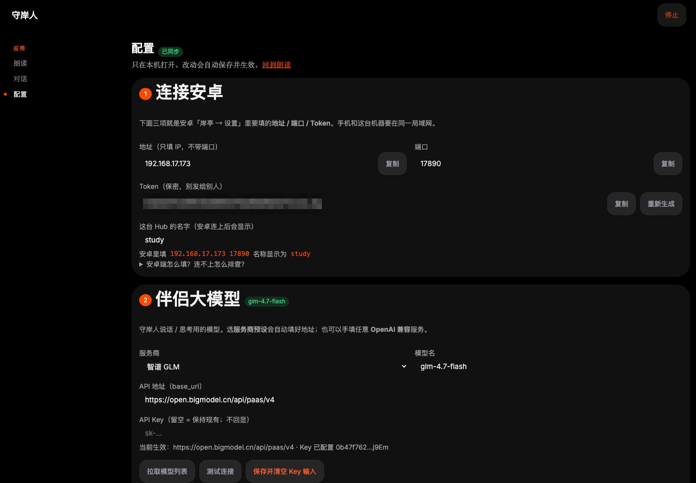
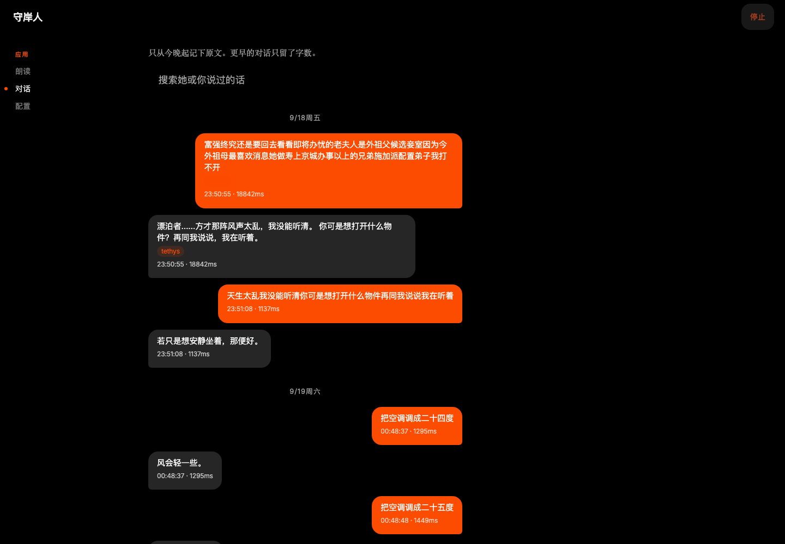
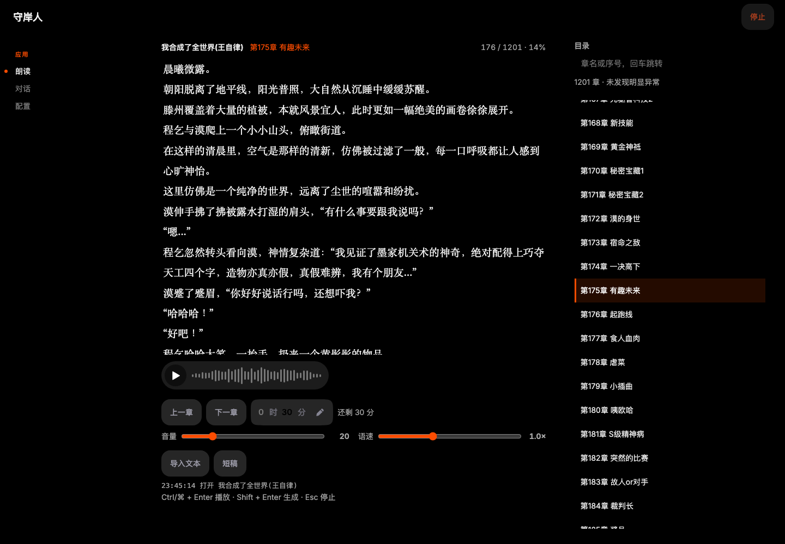

# 岸亭 Hub（Mac Mini）

Python 服务：对内调 [mijia-api](https://github.com/Do1e/mijia-api)、收 Windows 探针的 CPU、把启动项转发到 Windows；对外只提供 [Shoreting LAN Protocol v1](../docs/lan-protocol.md) 的 HTTP 接口。Windows 上用 `dock-hub --probe` 只做 CPU 上报和开程序。

安卓不直连米家，也看不到 `did` / 可执行文件路径。依赖 GPL-3.0 的 mijia-api：自用没问题；若分发 Hub，需要同样开源。

## 目录结构

```
hub/
  dock_hub/           # 源码包
    __main__.py       # CLI 入口（--hub 完整 Hub / --probe Windows 探针 / 托盘）
    server.py         # HTTP（含 /metrics 的 Prometheus 文本）
    metrics.py        # 进程内计数与直方图，无依赖
    service.py        # snapshot / command
    companion.py      # 守岸人主流程：chat 一轮、TTS 队列、打断；朗读任务已交出去
    intents.py        # 听懂一句话：中文数字、灯 / 亮度 / 温度、ACTION 行、口误折叠
    persona.py        # 怎么说：播报文案、情绪、mood.yaml 读写
    speech.py         # 断句、切块、拼 wav（朗读与 TTS 之间那层）
    llm.py            # 提示词组装、人设正文、两种流式回复的解析
    reads.py          # 朗读任务：排队、工作线程、wav 落盘与任务表
    actions.py        # ACTION 行落成设备动作：逐台执行、单台失败不连坐
    books.py          # 睡前朗读
    schedule.py       # 定时任务（到点开关设备 / 说一句）
    probe.py          # 探针模式（CPU 上报 + 远程开程序）
    pc.py             # CPU / 内存 / GPU / CPU 温度
    ledstrip.py       # 书桌 WS2812 灯带（ESP32 HTTP）
    mijia_bridge.py   # 米家设备
    setup_ui.py       # 配置向导（/setup）
    assets/           # 托盘与 exe 图标；rare.* 是 web/ 的构建产物
  web/                # 向导 / 朗读 / 睡前朗读页面前端源码（vite → dock_hub/assets/rare.*）
  dock_hub_entry.py   # PyInstaller 入口
  dock-hub.spec       # PyInstaller 规格
  build-exe.ps1       # 打成 dist/DockHub.exe
  run-admin.ps1       # 管理员启动（优先 exe）
  run_hub.pyw         # 无控制台源码启动（旧路径兼容）
  run-probe.bat / .vbs # Windows 计划任务静默拉起探针（pythonw，无黑窗）
  install-launchd.sh  # Mini 上装 LaunchAgent（开机自启）
  hub.yaml.example
  tests/
```

配置与日志（不进仓库）：

| 路径 | 用途 |
|------|------|
| `~/.config/dock-hub/hub.yaml` | 主配置 + token（Mini） |
| `~/.config/dock-hub/companion-chats.jsonl` | 守岸人对话原文（查看页 `/chats`） |
| `~/.config/dock-hub/reads/` | 朗读页生成的 wav |
| `~/.config/dock-hub/books/` | 睡前朗读的 txt 和 `progress.json` |
| `~/.config/mijia-api/auth.json` | 米家登录缓存（勿发给手机） |

## 要求

- Mac Mini：Python 3.10+（推荐 [uv](https://github.com/astral-sh/uv)），LaunchAgent `cn.weiekko.dock-hub`
- Windows 探针：同一套源码 `uv run dock-hub --probe`，防火墙放行入站 **TCP 17892**
- 安卓 Hub 栏填 Mini `10.83.22.121:17890`

## Mini 日常

```bash
cd hub
uv sync
./install-launchd.sh
```

配置向导：`http://127.0.0.1:17890/setup`（本机直接开；局域网先打开 `/chats` 登录或带 Token）。

## Windows 探针

```powershell
cd hub
uv sync
powershell -ExecutionPolicy Bypass -File .\build-exe.ps1
```

产物：`hub\dist\DockHub.exe`（无黑窗口 + 系统托盘，开机由计划任务 `HelmDockHub` 拉起）。托盘右键可打开 Mini 上的配置向导 / 聊天 / 朗读。

不要再让 Windows 占 `:17890`。探针端口是 **17892**。

1. **右键 → 以管理员身份运行**（或 `.\run-admin.ps1`，有 exe 时会优先启动它）
2. 托盘右键：**打开配置向导** 或 **退出**（首次启动会自动打开向导）
3. 配置向导地址：`http://127.0.0.1:17890/setup`（**仅本机**可访问）
4. 聊天记录：托盘 **打开聊天记录**，或浏览器打开 `http://127.0.0.1:17890/chats`（本机不用 Token；局域网填手机那枚 Token）
5. 朗读：托盘 **打开朗读**，或 `http://127.0.0.1:17890/read`。贴文稿或导入 txt，可只读选区；播放 / 生成 / 停止 / 再播 / 下载都在任务列表里
6. 安卓填向导里显示的 IP、端口 `17890`、Token

重新打包前先退出托盘里的旧进程。改 `dock_hub/companion.py` 后必须重新打 exe：正在跑的是 `dist\DockHub.exe`，只拷 `.py` 不会生效。

## 桌面伴侣

默认 `companion.tts.deliver: false`：Hub 流式读 LLM，每写出一句（`。！？`）就 cue Mini TTS（`play_only`）。`POST /v1/companion/chat` 仍等全文再返回给安卓字幕。`companion.llm.base_url` 可填 OpenAI 兼容地址（如阿里云 MaaS `qwen3.8-flash`），`api_key` 只写本机 yaml；请求顶层带 `enable_thinking: false`（推理型模型不关会把额度花在思考上）。未配密钥且 base 是 Ollama 时仍走 `/api/chat`（`think: false`）。TTS 仍指向 Mini。对话不预先读米家状态。白名单灯/开关/灯带可口头开关（`ACTION: id.on|off` 或「关灯」「开灯带」「开空调」兜底），真正执行仍走 devices/command。打断走 `POST /v1/companion/stop`。另有 `POST /v1/companion/announce` 让外部脚本（如微信机器人）直接让书桌喇叭说话；天气由 `GET /v1/weather` 代取。说明见 [docs/companion.md](../docs/companion.md)。

## 定时任务

`hub.yaml` 里加 `schedules`，Hub 每 15 秒看一次表，到点执行：

```yaml
schedules:
- id: morning
  at: "07:30"
  weekdays: [1, 2, 3, 4, 5]   # 不写就是每天；1=周一 … 7=周日
  on: [desk-lamp]              # 只能是 devices 里的 id
  say: "早，今天也要好好干活。"   # 走伴侣：companion 关着就只动作不说话
- id: bedtime
  at: "23:30"
  off: [desk-lamp]
  say: "灯关了，早点睡。"
```

- 只按分钟对齐，进程睡过头或那分钟没跑就跳过，不补发。
- 写错的 `at`（不是 `HH:MM`）、引用了不存在的设备 id、重复的 `id` 都会让 Hub 启动时报错，不会静默忽略。
- 定时任务在向导里不可编辑，但向导保存配置时会原样保留。

## 源码开发

```powershell
cd hub
uv sync
uv run dock-hub                      # 首次会自动生成 hub.yaml 并打开配置向导
uv run dock-hub --init              # 仅命令行：生成随机 token 的 hub.yaml
uv run dock-hub --list-devices      # 核对米家设备名
uv run dock-hub --dump-device "卧室温湿度计"
uv run dock-hub                     # 默认系统托盘
uv run dock-hub --no-tray           # 前台控制台，Ctrl+C 退出
uv run dock-hub --login             # 强制重新扫码登录米家（打开浏览器二维码）后退出
```

米家过期时：在配置向导里点 **「扫码登录米家」**，或运行 `--login`（命令行仍会打开浏览器）。

管理员无窗口（源码或 exe）：

```powershell
powershell -ExecutionPolicy Bypass -File .\run-admin.ps1
```

### 配置向导（推荐小白）

浏览器打开 `http://127.0.0.1:17890/setup`（托盘 → **打开配置向导**）。可图形化完成：



聊天记录、朗读 / 睡前朗读页（`/chats`、`/read`）：





1. 复制 **IP / Token** 到安卓
2. 米家扫码登录
3. 选温度源、灯/开关、启动程序
4. 修改后**自动保存**（改端口后需重启 Hub）

仍可直接编辑 `%USERPROFILE%\.config\dock-hub\hub.yaml`。

### 配置要点（`hub.yaml`）

- `token`：安卓 Bearer；`--init` 已生成
- `temperature`：只允许一个；没有就删整段
- `devices`：`light` / `switch` 用 `mijia_name`；`action` 用本机 `run.program`（路径不发给手机）；`ws2812` 用灯带 `base_url`（口头开关，Windows 开机亮、关机灭）
- `icon`：Remix 短名（如 `steam`、`cursor`、`computer`）；安卓据此画图标
- `pc.enabled: true`：snapshot 带 CPU / 内存；有 NVIDIA 再带 GPU；CPU 温度需管理员 + PawnIO（见下）

### PawnIO（CPU 温度，可选）

**是什么：** [PawnIO](https://pawnio.eu/) 是 Windows 上的小型驱动，让程序能读取 CPU 温度传感器。Hub 用它把温度显示在安卓主屏；**不装也能正常用** Hub 的其他功能，只是没有 CPU 温度这一项。

**还需要：** 岸亭 Hub 必须以**管理员**运行（右键 `DockHub.exe` → 以管理员身份运行，或 `run-admin.ps1`）。

**安装（任选一种）：**

```powershell
# 管理员 PowerShell / 终端
winget install -e --id namazso.PawnIO
```

或从 [GitHub Release](https://github.com/namazso/PawnIO/releases) / [pawnio.eu](https://pawnio.eu/) 下载安装包手动安装。

装完后退出 Hub，再**以管理员**重新启动。配置向导第 ⑤ 步也有同样说明。

示例见 `hub.yaml.example`。

### 防火墙（管理员 PowerShell）

```powershell
netsh advfirewall firewall add rule name="Shoreting Hub" dir=in action=allow protocol=TCP localport=17890
```

## 自测

把 `HOST`、`TOKEN` 换成实际值：

```powershell
curl.exe -s http://HOST:17890/health
curl.exe -s http://HOST:17890/v1/snapshot -H "Authorization: Bearer TOKEN"
curl.exe -s http://HOST:17890/v1/devices/lamp/command `
  -H "Authorization: Bearer TOKEN" -H "Content-Type: application/json" `
  -d "{\"on\":true,\"brightness\":80}"
curl.exe -s http://HOST:17890/v1/devices/steam/command `
  -H "Authorization: Bearer TOKEN" -H "Content-Type: application/json" `
  -d "{\"run\":true}"
```

`/health` 不必带 token。snapshot 不带 token 应为 401。

```powershell
uv run dock-hub --config D:\path\to\hub.yaml
uv run python -m unittest discover -s tests -v
```

## 同步到 Mac 仓库

本仓库权威副本在 Mac：`weiekko@10.83.22.121:/Users/weiekko/dock/`（IP 会变；SSH 不通时先看 ARP / known_hosts）。  
Windows 改完 Hub 后 scp 源码与说明（不要传 `.venv` / `build` / `dist`）：

```powershell
$mac = "weiekko@10.83.22.121"
ssh $mac "mkdir -p /Users/weiekko/dock/hub"
scp -r dock_hub tests pyproject.toml uv.lock README.md hub.yaml.example .gitignore `
  run-admin.ps1 run_hub.pyw build-exe.ps1 dock-hub.spec dock_hub_entry.py `
  ${mac}:/Users/weiekko/dock/hub/
scp ..\README.md ${mac}:/Users/weiekko/dock/README.md
```
